# AyudaCampus · Mesa de ayuda TI del campus

**Laboratorio 08 · MVVM + Room** · Programación en Móviles · 4to ciclo · Tecsup
**Alumno:** Alexander Faustino · **Docente:** Juan León S.

## Descripción

AyudaCampus es la mesa de ayuda de TI de un campus con **dos perfiles en el mismo dispositivo**:

- **Estudiante:** reporta incidencias (Wi-Fi, equipos, cuentas, impresión), conversa con Soporte, califica la atención y cierra o reabre sus tickets.
- **Soporte TI:** revisa un panel con contadores y gráficos, atiende la bandeja ordenada por prioridad, cambia estado y prioridad, responde y administra las categorías.

Ambos perfiles comparten la misma base de datos **Room**: cuando Soporte responde o cambia el estado de un ticket, el estudiante lo ve al instante gracias a `Flow`.


| Perfil | Correo                | Clave |
|---|-----------------------|---|
| Estudiante | `alex@campus.test`    | `1234` |
| Soporte TI | `soporte@campus.test` | `admin` |

*Datos ficticios, solo para pruebas.*

## Arquitectura MVVM


- **View:** solo observa el estado y avisa los eventos; no tiene reglas ni acceso a datos.
- **ViewModel:** valida y aplica las reglas de negocio; depende de la **interface** `AyudaRepository`, nunca de Room.
- **Model:** entidades, DAOs, base de datos, Repository y preferencias.

**Relaciones:** `usuarios` 1 → N `tickets` · `categorias` 1 → N `tickets` · `tickets` 1 → N `comentarios` (con borrado en cascada).

## Estructura de paquetes

```
com.faustino.ayudacampus
├── AyudaApp.kt                         Application: base de datos, repository y preferencias
├── MainActivity.kt
├── data
│   ├── local
│   │   ├── AyudaDatabase.kt            @Database (4 entidades, singleton)
│   │   ├── DatosIniciales.kt           5 categorías, 2 usuarios, 6 tickets, 4 comentarios
│   │   ├── entity                      Categoria · Usuario · Ticket · Comentario
│   │   ├── dao                         CategoriaDao · UsuarioDao · TicketDao
│   │   └── relation                    TicketConDetalle (@Embedded + @Relation)
│   ├── model                           Rol · EstadoTicket · Prioridad · ConteoCategoria
│   ├── repository                      AyudaRepository (interface) · AyudaRepositoryRoom
│   └── prefs                           PreferenciasStore (DataStore)
├── viewmodel
│   ├── AyudaViewModelFactory.kt
│   ├── SesionViewModel.kt              login, sesión, perfil y preferencias
│   ├── MisTicketsViewModel.kt          · NuevoTicketViewModel.kt · TicketDetalleViewModel.kt
│   ├── PanelViewModel.kt               · BandejaViewModel.kt · AtenderViewModel.kt
│   └── CategoriasViewModel.kt
└── ui
    ├── theme                           Color · Type · Theme (AyudaTheme por rol)
    ├── components                      AppTopBar · AyudaButton · AyudaTextField · EstadoChip
    │   │                               PrioridadChip · TicketCard · BurbujaComentario
    │   │                               StepperTicket · Estrellas · PerfilComponentes
    │   └── graficos                    GraficoDona · GraficoBarras (Canvas)
    ├── navigation                      Rutas · NavAyuda
    ├── cliente                         Splash · Login · MisTickets · NuevoTicket
    │                                   DetalleTicket · Perfil
    └── soporte                         Panel · Bandeja · AtenderTicket · Categorias
                                        FormularioCategoria · Ajustes
```


## Capturas

### Estudiante

<table>
  <tr>
    <td align="center">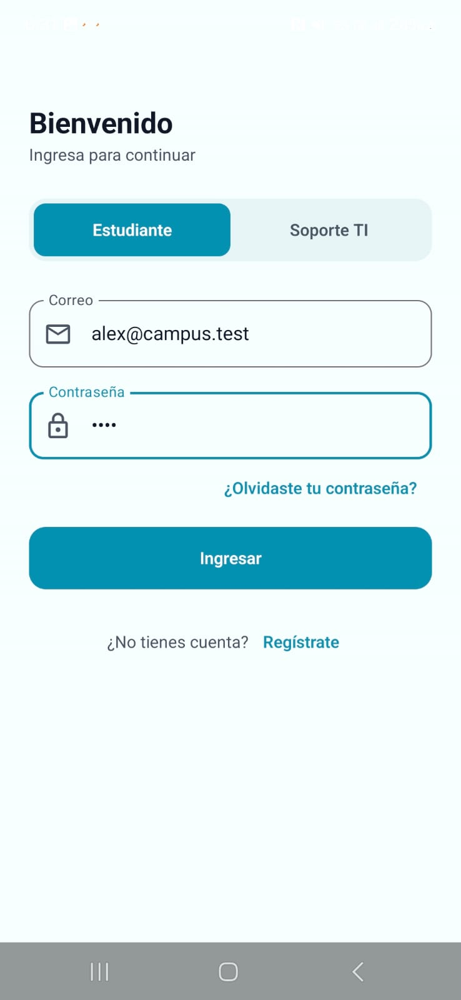<br>Inicio de sesión</td>
    <td align="center">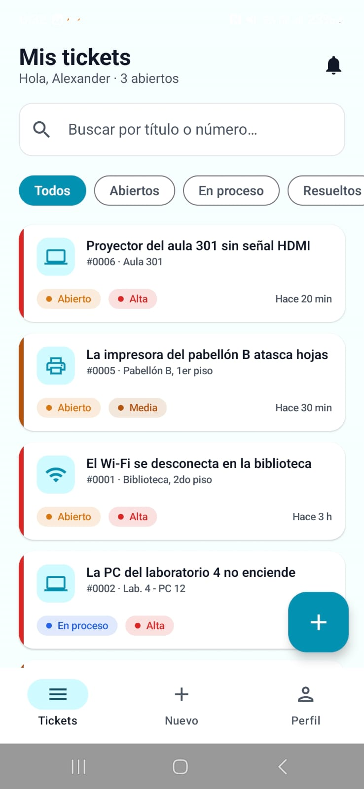<br>Mis tickets</td>
    <td align="center">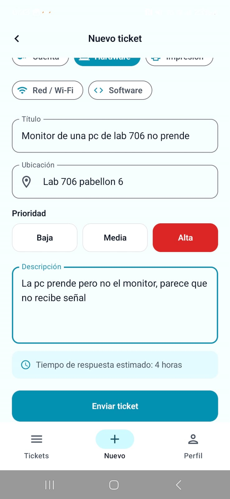<br>Nuevo ticket</td>
  </tr>
  <tr>
    <td align="center">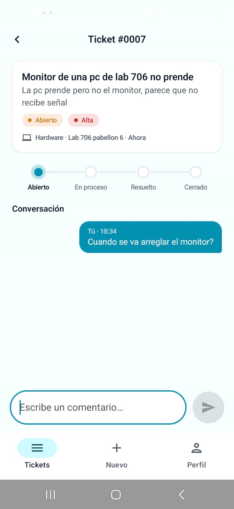<br>Detalle y conversación</td>
    <td align="center">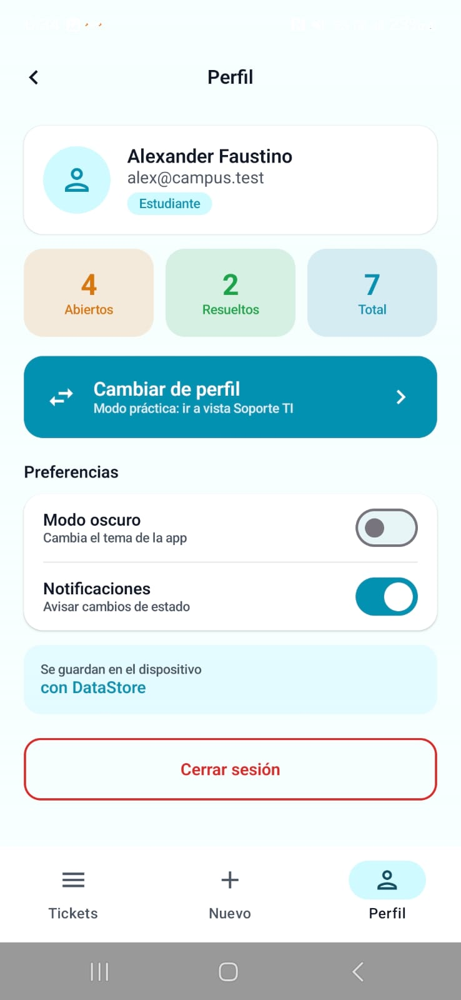<br>Perfil y preferencias</td>
    <td align="center">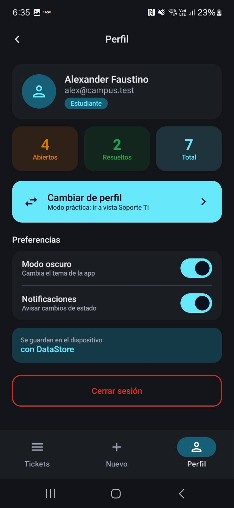<br>Perfil en modo oscuro</td>
  </tr>
</table>

### Soporte TI

<table>
  <tr>
    <td align="center">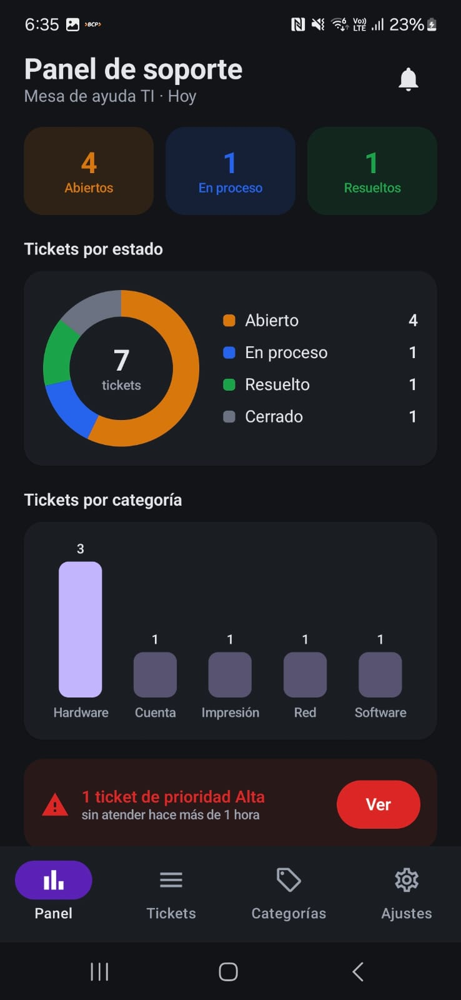<br>Panel con gráficos</td>
    <td align="center">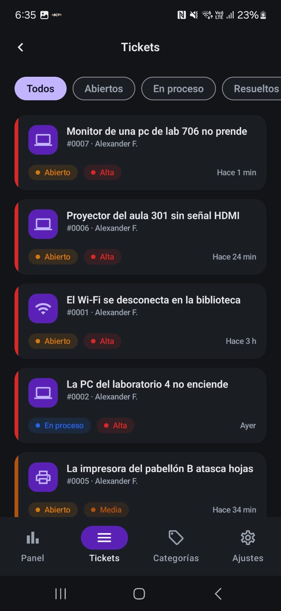<br>Bandeja de tickets</td>
    <td align="center">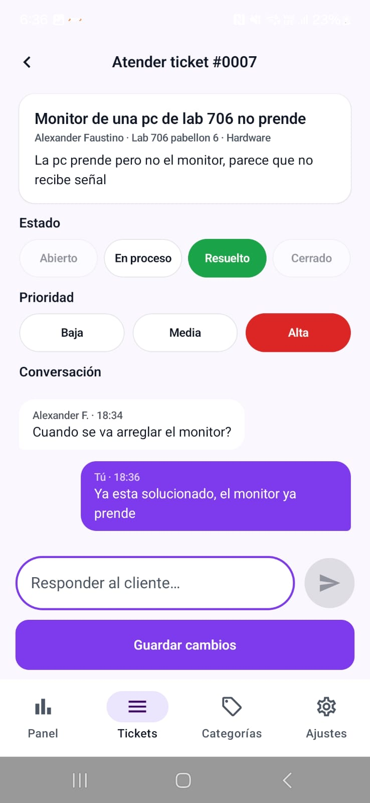<br>Atender ticket</td>
  </tr>
  <tr>
    <td align="center">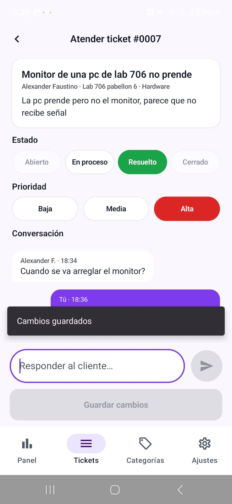<br>Cambios guardados</td>
    <td align="center">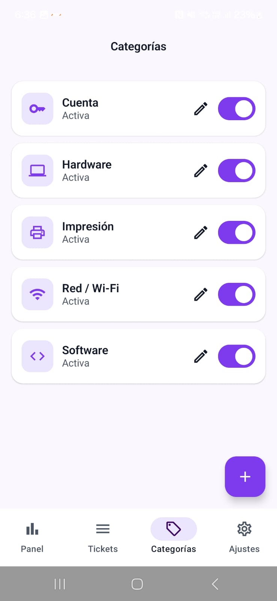<br>Categorías</td>
    <td align="center">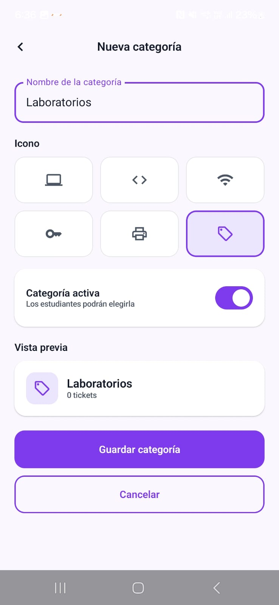<br>Nueva categoría</td>
  </tr>
  <tr>
    <td align="center">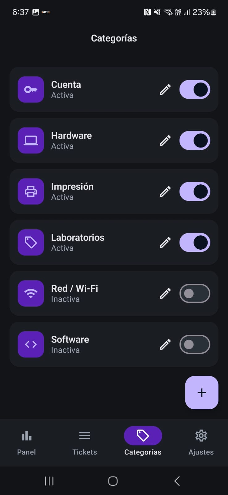<br>Categoría creada y otras desactivadas</td>
    <td align="center">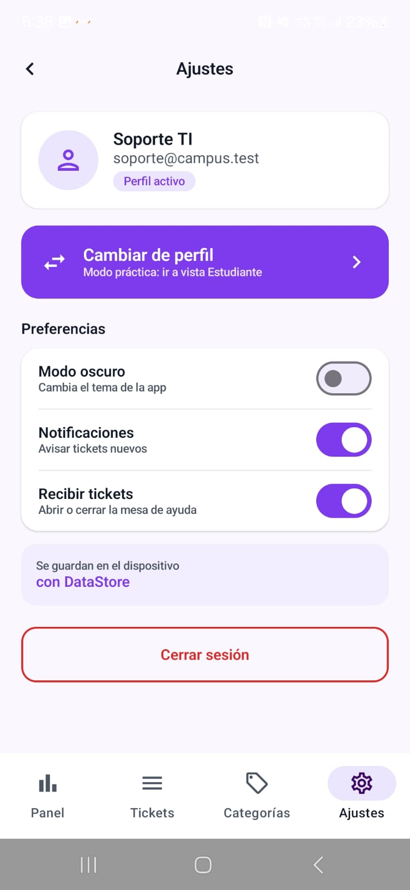<br>Ajustes</td>
    <td></td>
  </tr>
</table>

*El ticket #0007 recorre todo el flujo: el estudiante lo crea con prioridad Alta, comenta, y Soporte responde y lo marca como Resuelto. Las capturas en modo oscuro muestran que la preferencia se aplica en ambos perfiles.*


## Pruebas de aceptación

| Prueba | Resultado esperado | OK |
|---|---|:---:|
| Login con clave incorrecta | Mensaje de error, no entra | ✅ |
| Estudiante: crear ticket vacío | Errores junto a cada campo, no se crea | ✅ |
| Estudiante: crear ticket válido | Aparece en Mis tickets como ABIERTO con la prioridad elegida | ✅ |
| Soporte: bandeja | El ticket nuevo aparece; los de prioridad Alta salen primero | ✅ |
| Soporte: pasar a En proceso y responder | El estudiante ve el nuevo estado y la respuesta sin reiniciar | ✅ |
| Soporte: intentar cerrar un ticket | La opción Cerrado está deshabilitada | ✅ |
| Soporte: marcar Resuelto | El estudiante ve el aviso verde, califica con 4 estrellas y cierra | ✅ |
| Estudiante: reabrir un ticket resuelto | Vuelve a Abierto y se borra la calificación | ✅ |
| Comentar en un ticket cerrado | El campo no aparece | ✅ |
| Panel | Contadores y gráficos coinciden con la bandeja; la alerta cuenta las ALTA abiertas con más de 1 hora | ✅ |
| Desactivar una categoría | Ya no se puede elegir al crear un ticket | ✅ |
| Cerrar y abrir la app | Los tickets siguen ahí y el perfil y el modo oscuro se recuerdan | ✅ |

## Para pensar

| Pregunta | Respuesta |
|---|---|
| ¿Por qué las reglas de estado están en el ViewModel? | Son lógica de negocio: el DAO solo guarda y consulta, y el Composable solo dibuja; en el ViewModel se aplican igual desde cualquier pantalla y se prueban sin UI. |
| ¿Por qué `crearTicket` es suspend y `observarTicket` es Flow? | Crear es una acción única que se ejecuta y termina; observar es una lectura que debe avisar cada cambio en la base para que la pantalla se actualice sola. |
| ¿Qué pasaría si un ticket se cerrara sin calificación? | Se perdería la opinión del estudiante y habría tickets cerrados sin evaluar, rompiendo la regla RESUELTO → CERRADO con 1 a 5 estrellas. |
| ¿Qué cambiaría si los tickets vivieran en un servidor? | Solo crearía otra implementación de `AyudaRepository` (por ejemplo con Retrofit) y la usaría en `AyudaApp`; ViewModels y pantallas no cambian porque dependen de la interface. |
