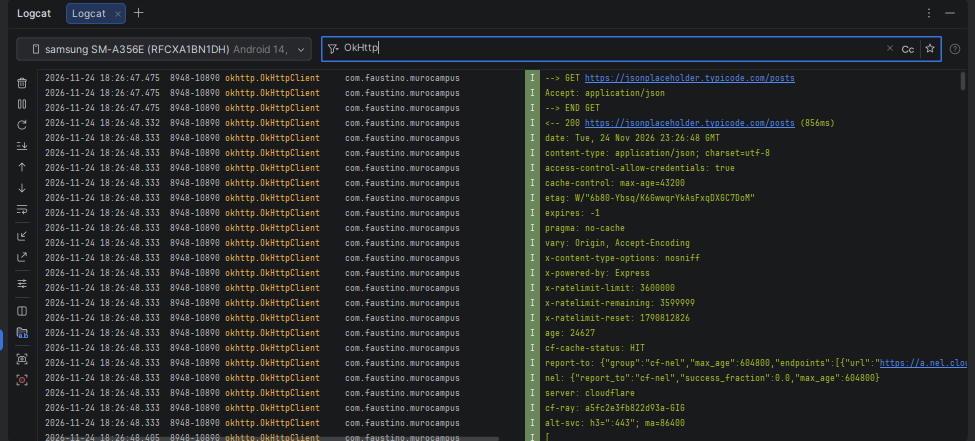
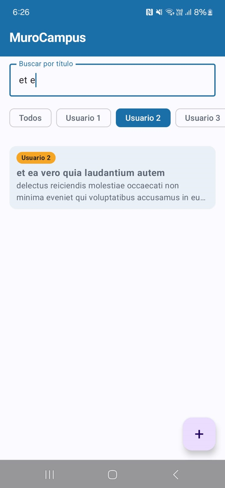
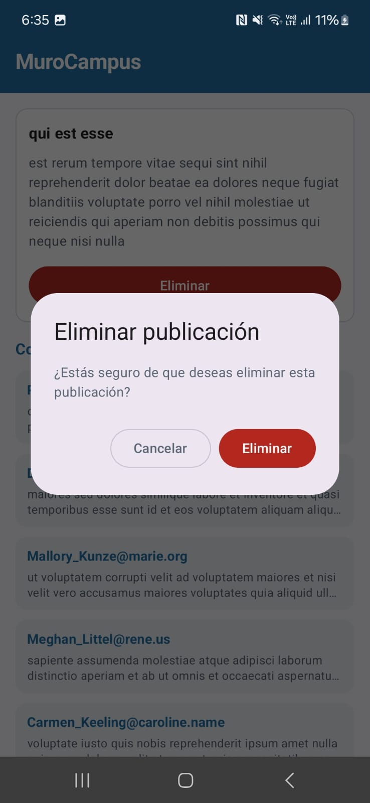
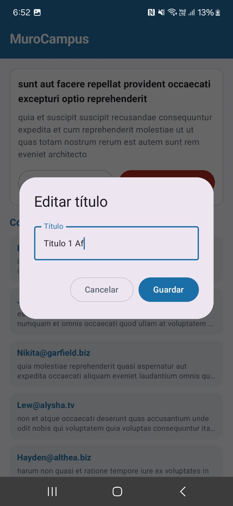
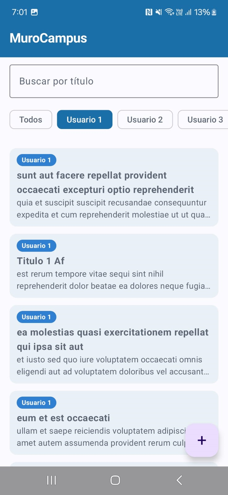

# PROMPTS.md: Fase 2 (rama mejora-ia)

Herramienta de IA: **Gemini en Android Studio**.

En cada mejora trabajé así: escribí el prompt, Gemini mostró **solo el plan** sin tocar código, revisé el plan contra las reglas de la arquitectura, lo aprobé con ajustes y luego probé el resultado en el emulador y con Logcat antes de hacer el commit.

## Contexto común (incluido al inicio de cada prompt)

> App Android MuroCampus (Kotlin, Jetpack Compose, MVVM + Repository, Retrofit con kotlinx.serialization), paquete com.faustino.murocampus. Capas: ui/ (solo conoce PostsViewModel), viewmodel/ (PostsViewModel con StateFlow de UiState, solo conoce la interface PostRepository), data/ (PostRepository y PostRepositoryRemote, que devuelve Result y relanza CancellationException antes de capturar Exception) y data/remote/ (PostApi y RetrofitClient). Reglas: no usar Retrofit, PostApi ni HttpException en el ViewModel; la pantalla nunca llama a la API; el Repository no deja escapar excepciones. Cambiar lo mínimo necesario y respetar el estilo del código existente.

## Cierre común (al final de cada prompt)

> Antes de tocar el código, muéstrame el plan que vas a realizar: qué archivos modificarás y qué cambiarás en cada uno. No modifiques ningún archivo hasta que yo apruebe el plan.

## Tabla de prompts

| Prompt que escribí | Qué respondió Gemini | Qué cambié o descarté | Por qué |
|---|---|---|---|
| **Mejora 1, interceptor.** «[Contexto común] En RetrofitClient.kt tengo un OkHttpClient.Builder() con un HttpLoggingInterceptor en nivel BODY. Quiero agregar un Interceptor de OkHttp que añada el encabezado Accept: application/json a todas las peticiones, de forma que el log de OkHttp muestre ese encabezado. No toques el ViewModel, el Repository ni las pantallas. [Cierre común]» | Plan: modificar solo RetrofitClient.kt, agregando con addInterceptor un interceptor que construye la petición con newBuilder().addHeader("Accept", "application/json") y llama a chain.proceed, colocado antes del HttpLoggingInterceptor para que el log ya muestre el encabezado. | Aprobé el plan pidiendo usar header(...) en lugar de addHeader(...). | header() reemplaza un Accept existente en vez de duplicarlo. Comprobé en Logcat (filtro OkHttp) que la petición muestra Accept: application/json y que la app sigue cargando las 100 publicaciones. |
| **Mejora 2, búsqueda.** «[Contexto común] Agrega en PantallaLista un campo de búsqueda que filtre por título las publicaciones ya descargadas, sin nuevas llamadas a la red, combinado con el filtro por usuario. El texto debe vivir en el ViewModel y sobrevivir a una rotación. Si no hay coincidencias, mostrar "Sin publicaciones". Solo cambian ViewModel y View. El campo y los chips se ocultan si hay error de conexión. [Cierre común]» | Plan: en PostsViewModel agregar _busqueda con buscar(texto) y una lista interna _listaRaw combinada con la búsqueda mediante combine, filtrando con contains(ignoreCase) solo cuando el estado es Exito; en PantallaLista agregar un OutlinedTextField sobre los chips, dentro del bloque que ya se oculta con UiState.Error. | Pedí que el StateFlow público "lista" conservara su nombre y tipo usando stateIn con WhileSubscribed(5000), que se usara trim() además de ignoreCase, y que el campo fuera singleLine con la etiqueta "Buscar por título". | Para no romper PantallaLista ni MainActivity, evitar que un espacio al final dejara la lista vacía y mantener la interfaz clara. Verifiqué que al escribir no se hacen peticiones nuevas (Logcat) y que la búsqueda se conserva al rotar. |
| **Mejora 3, borrar.** «[Contexto común] Agrega la opción de borrar una publicación desde el detalle: en PostApi un @DELETE("posts/{id}") que devuelva Response<Unit>; en el Repository una función borrar(id) con Result<Unit> que revise si la respuesta fue exitosa y, si no, devuelva un failure que mensajeDe pueda convertir; en el ViewModel un estado propio del borrado y quitar la publicación de la lista porque JSONPlaceholder no borra de verdad; en PantallaDetalle un botón "Eliminar" con confirmación que vuelva a la lista (la navegación vive en MainActivity con idSeleccionado). [Cierre común]» | Plan sobre cinco archivos (PostApi, PostRepository, PostsViewModel, PantallaDetalle y MainActivity): borrar devuelve Result.failure(HttpException(resp)) si no es exitoso, el ViewModel tiene _borrado y quita el post de _listaRaw, la pantalla tiene el botón y un AlertDialog, y MainActivity conecta onVolver = { idSeleccionado = null }. | Pedí: leer _listaRaw y filtrar solo si es Exito; poner _borrado en Cargando y deshabilitar el botón Eliminar y el de confirmar mientras tanto; llamar a reiniciarBorrado() dentro de abrir(id); mostrar Eliminar solo con el detalle cargado y guardar el diálogo con rememberSaveable. | Evitar errores si la lista no estaba cargada, el doble toque, y que el error de un borrado fallido apareciera al abrir otra publicación. El HttpException queda solo en el Repository (capa de datos), no en el ViewModel. |
| **Mejora 3, corrección tras mis pruebas.** «[Contexto breve] La función de borrar ya funciona, pero al cambiar el filtro de usuario la publicación borrada reaparece porque JSONPlaceholder no borra de verdad. Mientras la app esté abierta, las publicaciones borradas no deben volver a aparecer. Propón guardar en el ViewModel el conjunto de ids borrados y excluirlo al calcular la lista pública. Solo cambia PostsViewModel. [Cierre común]» | Plan: agregar _borrados (MutableStateFlow de Set de Int), registrarlo en onSuccess de borrar(id) y combinarlo con la lista interna y la búsqueda con combine de tres flujos, excluyendo los ids borrados, sin cambiar el nombre ni el tipo de "lista". | Pedí usar _borrados.update { it + id } en vez de reasignar el valor, y eliminar la lógica anterior que quitaba el post de _listaRaw. | update es atómico y deja una sola fuente de verdad. El fallo lo encontré yo en las pruebas: tras borrar y cambiar de filtro, la lista se vuelve a descargar del servidor y la publicación reaparecía. |
| **Mejora 4, editar con PATCH.** «[Contexto común] Agrega la opción de editar solo el título desde el detalle: una data class @Serializable con title; en PostApi un @PATCH("posts/{id}") con @Path y @Body que devuelva Post; en el Repository una función con Result<Post>; en el ViewModel un estado de edición y, como JSONPlaceholder no guarda cambios, recordar los títulos editados (mapa de id a título) y aplicarlos a la lista y al detalle; en PantallaDetalle un botón "Editar" con un diálogo con "Guardar" deshabilitado si está vacío o guardando, y error dentro del diálogo conservando lo escrito. [Cierre común]» | Plan sobre cinco archivos: EditarTituloPost en Modelos.kt, editarTitulo en PostApi y en el Repository (con el bloque llamar), en el ViewModel _edicion y _titulosEditados aplicados en el combine y en abrir(id), y en PantallaDetalle el botón Editar con un AlertDialog. | Pedí: botón Cancelar (y al descartar) que cierre el diálogo y llame a reiniciarEdicion(); el campo abre siempre con el título mostrado y se guarda con rememberSaveable; actualizar _detalle solo si es Exito del mismo id usando copy(title = ...); enviar el título con trim() y no permitir guardar vacío; conservar los nombres de "lista" y "detalle". | El plan no limpiaba el error de edición al cancelar y reaparecería al reabrir; así evito sobrescribir el detalle de otra publicación y enviar títulos vacíos. Probé editar, cambiar de filtro, recargar y buscar por el título nuevo, y revisé en Logcat el PATCH. |

## Verificación de reglas

- Revisé con búsqueda de texto que viewmodel/PostsViewModel.kt no contiene retrofit, PostApi ni HttpException.
- Las pantallas solo llaman al ViewModel, nunca a la API.
- El Repository sigue devolviendo Result y relanza CancellationException antes de capturar Exception.
- Las mejoras 3 y 4 cambian API, Repository, ViewModel y View; las mejoras 1 y 2 cambian RetrofitClient y ViewModel y View respectivamente.

## Capturas de las mejoras

### Mejora 1: interceptor con encabezado Accept

Logcat filtrado por OkHttp: la petición GET incluye el encabezado `Accept: application/json`.

### Mejora 2: búsqueda por título

Texto escrito en el buscador y la lista filtrada, sin nuevas peticiones a la red.

### Mejora 3: borrar publicación

Diálogo de confirmación en el detalle 

### Mejora 4: editar el título con PATCH

Diálogo de edición con el título nuevo y el detalle con el título actualizado.

## Commits de la Fase 2

| Mejora | Commit |
|---|---|
| 1 | feat(red): agrega interceptor con encabezado Accept |
| 2 | feat(busqueda): filtra publicaciones por titulo |
| 3 | feat(borrar): elimina publicacion con DELETE |
| 4 | feat(editar): edita el titulo con PATCH |