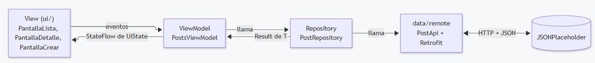
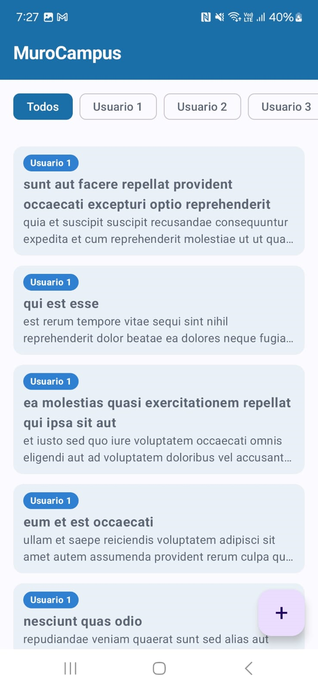
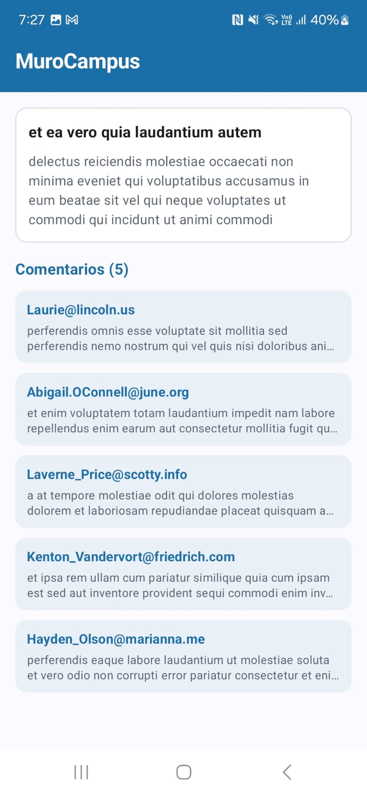
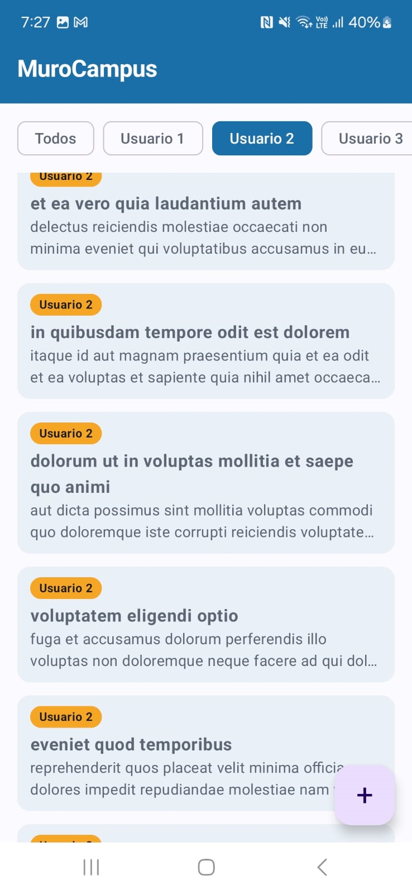
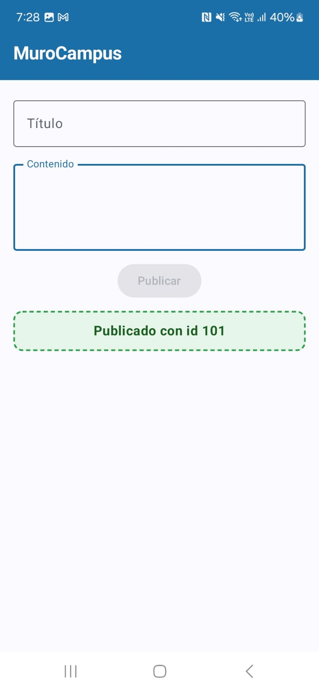
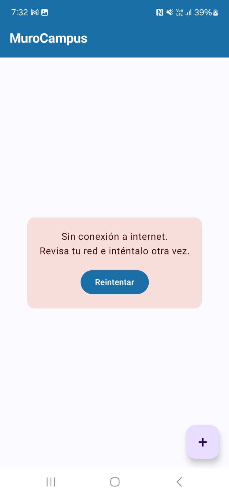

# MuroCampus

**Autor:** Alexander Faustino Quispe

**Laboratorio:** Servicios Web y plataforma REST (Semana 09)

## Descripción

MuroCampus es una app Android hecha con Kotlin y Jetpack Compose que consume un servicio web REST (JSONPlaceholder). Permite listar publicaciones, ver el detalle con sus comentarios, filtrar por usuario y crear una publicación nueva. Cuando no hay internet o el servidor falla, muestra un mensaje claro con el botón **Reintentar** en lugar de cerrarse.

Tecnologías: Retrofit, OkHttp, kotlinx.serialization, ViewModel, StateFlow y Compose.

## Estructura de paquetes

```
com.faustino.murocampus/
├── MainActivity.kt
├── model/
│   └── Modelos.kt              Usuario, Post, Comentario, NuevoPost
├── data/
│   ├── remote/
│   │   ├── PostApi.kt          interface de Retrofit
│   │   └── RetrofitClient.kt   cliente Retrofit y OkHttp
│   └── PostRepository.kt       interface + PostRepositoryRemote
├── viewmodel/
│   ├── PostsViewModel.kt       lista, detalle, filtro y crear
│   ├── PostsViewModelFactory.kt
│   └── UiState.kt              Cargando, Exito, Error
└── ui/
    ├── Componentes.kt          TarjetaPost, Cargando, ErrorConReintento
    ├── PantallaLista.kt
    ├── PantallaDetalle.kt
    ├── PantallaCrear.kt
    └── theme/
```

## Arquitectura MVVM + Repository



- **View:** solo conoce a su ViewModel y dibuja el estado con un `when`.
- **ViewModel:** solo conoce la interface `PostRepository` y convierte `Result` en `UiState`.
- **Repository:** convierte las excepciones de red en `Result.failure`.
- **data/remote:** habla con Retrofit, OkHttp y el JSON.

## Capturas

| Lista | Detalle | Filtro |
|--|---|---|
|  | | |

| Crear | Error de conexión |
|---|---|
|  |  |

## Para pensar

**1. ¿Qué diferencia hay entre GET y POST? ¿Por qué crear lleva @Body y porUsuario lleva @Query?**

GET pide datos sin modificar nada en el servidor y no lleva cuerpo. POST envía datos para crear algo nuevo. `crear` usa `@Body` porque el objeto `NuevoPost` viaja como JSON dentro del cuerpo de la petición. `porUsuario` usa `@Query` porque es un filtro que va en la URL (`posts?userId=2`) dentro de un GET, que no tiene cuerpo.

**2. ¿Por qué la ruta es "posts" y no "/posts"?**

Una ruta sin barra se agrega a la URL base. Con barra inicial, Retrofit la toma como ruta absoluta y reemplaza todo el camino de la URL base. Con JSONPlaceholder no se notaría, pero si la base fuera `https://servidor.com/api/v1/`, se perdería `/api/v1/`.

**3. ¿Por qué el Repository devuelve Result en vez de dejar que la excepción llegue al ViewModel?**

Las excepciones de red (`IOException`, `HttpException`, `SerializationException`) son un detalle de la capa de datos. Si llegaran al ViewModel, este tendría que conocer Retrofit y, si no las captura, la app se cierra. Con `Result`, el éxito y el fallo son valores explícitos que el ViewModel debe manejar, las capas quedan separadas y se puede cambiar la fuente de datos o probar con un repositorio falso.

**4. ¿Qué pasa si olvidas el permiso INTERNET? ¿Y si olvidas ignoreUnknownKeys y el servidor agrega un campo nuevo?**

Sin el permiso, la app compila pero nunca se conecta: aparece un error de red aunque el dispositivo tenga internet. Sin `ignoreUnknownKeys`, `kotlinx.serialization` lanza una `SerializationException` al encontrar un campo que no está en la data class, y la app muestra "Respuesta inesperada" aunque los campos que usamos sí llegaron.

**5. ¿Por qué la pantalla de lista usa un when sobre UiState y no un if con tres variables?**

Con tres variables (cargando, error, datos) pueden quedar combinaciones imposibles, como cargando y error a la vez. `UiState` es una `sealed interface`: solo un estado a la vez, el `when` es exhaustivo (el compilador obliga a cubrir todos los casos) y los datos solo están disponibles en `Exito`.

**6. JSONPlaceholder no guarda los POST. ¿Cómo cambiaría tu app si usaras un servicio real?**

Después de crear, habría que refrescar la lista o insertar la publicación devuelta, para que aparezca. El `userId` saldría del usuario autenticado y no estaría fijo en 1. Haría falta autenticación (por ejemplo un interceptor de OkHttp con el encabezado `Authorization`), manejo de errores como 401, 403 o 422, y probablemente paginación y caché. Gran parte del cambio estaría en el Repository y la API; la View casi no se tocaría.