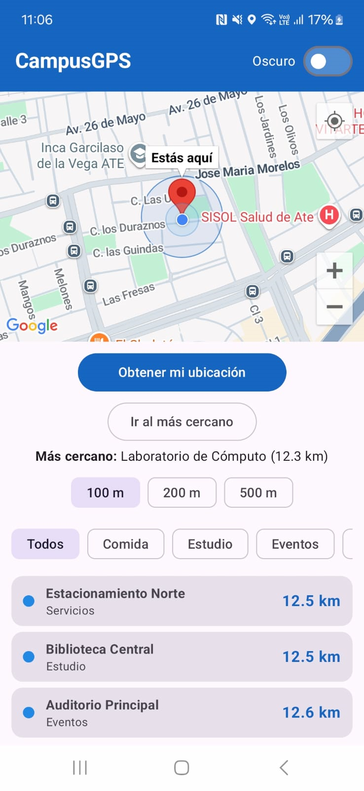
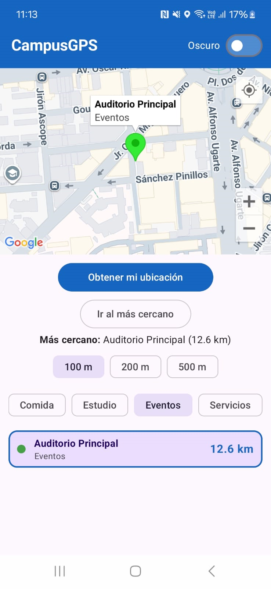
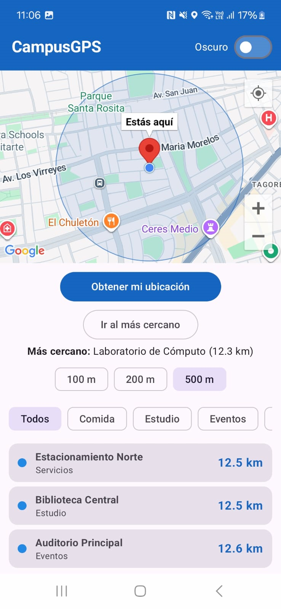
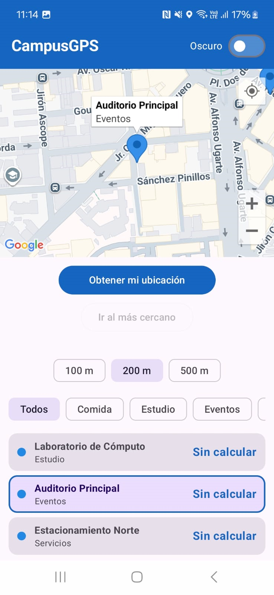
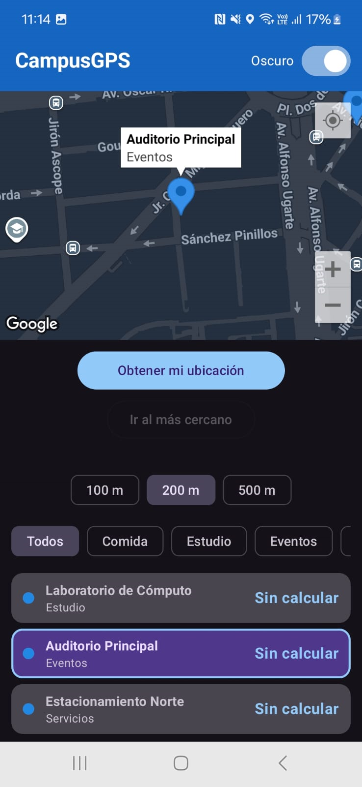

# PROMPTS.md · Fase 2 (CampusGPS)

Herramienta usada: Gemini (integrado en Android Studio)

Método de trabajo: en cada mejora le pasé a la IA el contexto del proyecto, la mejora
pedida y las reglas obligatorias (la View solo habla con el ViewModel, el ViewModel no usa
Context, todo acceso a APIs de Android o Google va en el Repository, cambiar lo mínimo
posible, no incluir claves de API). Al final le pedí que me mostrara solo el plan y no
tocara nada hasta que yo respondiera "aprobado". Revisé cada plan, lo aprobé con ajustes
y después compilé (`app:assembleDebug`) y probé la app en el celular.

| Prompt que escribí | Qué respondió la IA | Qué cambié o descarté | Por qué |
|---|---|---|---|
| **Mejora 1 · Punto azul nativo**  Estoy trabajando en CampusGPS, una app Android en Kotlin con Jetpack Compose y Google Maps (maps-compose). Usa arquitectura MVVM + Repository con los paquetes com.faustino.campusGPS.{data, model, ui, util, viewmodel}.  Reglas que NO se pueden romper: 1. La View (Composables) solo habla con MapaViewModel: recibe estado por parámetros y envía eventos por lambdas. No contiene lógica de negocio ni cálculos. 2. El ViewModel depende solo de interfaces (UbicacionRepository, LugaresRepository) y NO recibe ni usa Context. 3. Todo acceso a APIs de Android o Google (FusedLocationProviderClient, etc.) va dentro de las implementaciones del Repository. 4. Las distancias ya se calculan en el ViewModel con util/distanciaMetros; no las recalcules en un Composable. 5. Cambia lo mínimo posible, mantén los nombres y firmas existentes salvo lo que pida la tarea, y no reescribas archivos completos si no hace falta. 6. No incluyas ninguna clave de API en el código.  Mejora: punto azul nativo de Google Maps.  Tarea: activa la capa de "mi ubicación" del mapa (isMyLocationEnabled) y el botón de mi ubicación (myLocationButtonEnabled) usando MapProperties y MapUiSettings de maps-compose en MapaUbicacion.  Condiciones: - Solo debe activarse si el permiso de ubicación (fine o coarse) ya fue concedido. Sin permiso, isMyLocationEnabled = true provoca SecurityException, así que nunca debe activarse sin permiso. - Agrega a MapaUbicacion un parámetro Boolean (por ejemplo permisoConcedido). Es un cambio solo de View: no toques el ViewModel ni el Repository. - En PantallaMapa calcula ese Boolean con ContextCompat.checkSelfPermission y haz que se actualice cuando el usuario concede el permiso en el cuadro del sistema (en el callback del launcher que ya existe). - Conserva el marcador rojo "Estás aquí" y todo lo demás sin cambios. Responde en español.  IMPORTANTE: ANTES de modificar cualquier archivo o escribir código, muéstrame solo el plan: qué archivos vas a tocar, qué cambiará en cada uno y qué NO vas a tocar. No generes código todavía. Espera a que yo responda "aprobado" para continuar. | Plan: tocar `MapaUbicacion.kt` (parámetro `permisoConcedido`, `MapProperties` y `MapUiSettings`) y `PantallaMapa.kt` (cálculo del permiso con `checkSelfPermission` y actualización en el callback del launcher). No tocar ViewModel, Repository ni modelos. | Revisé el plan y detecté un caso no cubierto: si el usuario activa el permiso desde Ajustes y vuelve a la app, pulsar "Obtener mi ubicación" llama directo a `vm.buscar()` sin pasar por el launcher, así que `permisoConcedido` seguía en `false`. Pedí actualizarlo también dentro de `alPulsar()` y extraer la comprobación fine/coarse a una función local para no duplicar código. Gemini aplicó el ajuste y compiló. | Sin ese ajuste el punto azul no aparecía aunque el permiso ya estuviera concedido. |
| **Mejora 1 · Punto azul nativo** (aprobación)  Aprobado, con un ajuste al plan de PantallaMapa: el estado permisoConcedido también debe actualizarse dentro de alPulsar() cuando el permiso ya está concedido (por ejemplo, si el usuario lo activó desde Ajustes y vuelve a la app), no solo en el callback del launcher. Extrae la comprobación fine/coarse a una función local para no duplicar código. Lo demás queda como en el plan. Procede con la implementación y muéstrame solo lo que cambia en cada archivo. | Implementó `permisoConcedido` como parámetro de `MapaUbicacion`, `properties` y `uiSettings` con `remember(permisoConcedido)`, y actualizó el estado en el launcher y en `alPulsar()`. Mantuvo el marcador "Estás aquí". | Revisé el diff y lo dejé tal cual. | El ajuste de `alPulsar()` era necesario para el caso de permiso activado desde Ajustes. |
| **Mejora 2 · Filtrar por categoría**  Estoy trabajando en CampusGPS, una app Android en Kotlin con Jetpack Compose y Google Maps (maps-compose). Usa arquitectura MVVM + Repository con los paquetes com.faustino.campusGPS.{data, model, ui, util, viewmodel}.  Reglas que NO se pueden romper: 1. La View (Composables) solo habla con MapaViewModel: recibe estado por parámetros y envía eventos por lambdas. No contiene lógica de negocio ni cálculos. 2. El ViewModel depende solo de interfaces (UbicacionRepository, LugaresRepository) y NO recibe ni usa Context. 3. Todo acceso a APIs de Android o Google (FusedLocationProviderClient, etc.) va dentro de las implementaciones del Repository. 4. Las distancias ya se calculan en el ViewModel con util/distanciaMetros; no las recalcules en un Composable. 5. Cambia lo mínimo posible, mantén los nombres y firmas existentes salvo lo que pida la tarea, y no reescribas archivos completos si no hace falta. 6. No incluyas ninguna clave de API en el código.  Mejora: filtrar lugares por categoría con chips.  Tarea: - ViewModel: agrega categorias: StateFlow<List<String>> (las categorías distintas obtenidas de los lugares, sin escribirlas a mano), categoriaSeleccionada: StateFlow<String?> (null = todas), fun seleccionarCategoria(categoria: String?) y lugaresFiltrados: StateFlow<List<LugarConDistancia>> que combine lugares y la categoría elegida (usa combine y stateIn). - El lugar más cercano (masCercano) debe calcularse sobre lugaresFiltrados, para que coincida con lo que se ve. - Si el lugar seleccionado queda fuera del filtro, la selección debe limpiarse (seleccionado = null) dentro del ViewModel. - Respeta el orden de inicialización de las propiedades del ViewModel: una propiedad derivada debe declararse después de las que usa. - View: una fila de FilterChip (Todos + una por categoría) en PantallaMapa, sobre la lista y desplazable horizontalmente. El mapa y la lista usan solo lugaresFiltrados. - El filtrado vive solo en el ViewModel; los Composables solo pintan lo que reciben. No cambies el Repository.  Responde en español.  IMPORTANTE: ANTES de modificar cualquier archivo o escribir código, muéstrame solo el plan: qué archivos vas a tocar, qué cambiará en cada uno y qué NO vas a tocar. No generes código todavía. Espera a que yo responda "aprobado" para continuar. | Plan: `MapaViewModel.kt` (`categorias`, `categoriaSeleccionada`, `seleccionarCategoria()`, `lugaresFiltrados` con `combine` + `stateIn`, `masCercano` sobre lugares filtrados) y `PantallaMapa.kt` (fila de `FilterChip` en `LazyRow`). | Revisé el plan y encontré tres riesgos. (1) El plan decía "comprueba si el lugar sigue dentro de los filtrados", y leer `lugaresFiltrados.value` justo después de cambiar la categoría daría el valor anterior, porque un `StateFlow` con `stateIn` se actualiza de forma asíncrona. (2) Los chips no debían verse en `UbicacionUi.Error`. (3) "Más cercano" debía seguir mostrando su distancia con la lista filtrada. Pedí que la comprobación usara la categoría recibida y `_lugares.value`, y que los chips se ocultaran en error. | El primer riesgo causaría que, a veces, un lugar oculto siguiera seleccionado. Los chips en error filtrarían algo que no se muestra. |
| **Mejora 2 · Filtrar por categoría** (aprobación)  Aprobado, con tres ajustes: 1. En seleccionarCategoria, NO leas lugaresFiltrados.value para decidir si limpiar la selección: un StateFlow creado con stateIn se actualiza de forma asíncrona y devolvería el valor anterior. Haz la comprobación con datos directos: usa la categoría recibida por parámetro y la lista base _lugares.value (si el lugar seleccionado existe y su categoría no coincide con la nueva, pon seleccionado = null; si la nueva categoría es null, no limpies nada). 2. La fila de chips solo se muestra cuando el estado NO es UbicacionUi.Error, igual que el mapa y la lista. 3. Asegúrate de que el texto "Más cercano: nombre (distancia)" y el botón "Ir al más cercano" sigan funcionando con la lista filtrada. | Implementó los StateFlows, `seleccionarCategoria()` con la comprobación directa sobre `_lugares.value`, y la fila de chips visible solo fuera de `UbicacionUi.Error`. "Más cercano" y el botón usan `lugaresFiltrados`. Compiló sin errores. | Revisé el diff y acepté los cambios. | Los ajustes evitan la carrera de lectura del `StateFlow` y que los chips aparezcan en error. |
| **Mejora 3 · Radio de cercanía**  Estoy trabajando en CampusGPS, una app Android en Kotlin con Jetpack Compose y Google Maps (maps-compose). Usa arquitectura MVVM + Repository con los paquetes com.faustino.campusGPS.{data, model, ui, util, viewmodel}.  Reglas que NO se pueden romper: 1. La View (Composables) solo habla con MapaViewModel: recibe estado por parámetros y envía eventos por lambdas. No contiene lógica de negocio ni cálculos. 2. El ViewModel depende solo de interfaces (UbicacionRepository, LugaresRepository) y NO recibe ni usa Context. 3. Todo acceso a APIs de Android o Google (FusedLocationProviderClient, etc.) va dentro de las implementaciones del Repository. 4. Las distancias ya se calculan en el ViewModel con util/distanciaMetros; no las recalcules en un Composable. 5. Cambia lo mínimo posible, mantén los nombres y firmas existentes salvo lo que pida la tarea, y no reescribas archivos completos si no hace falta. 6. No incluyas ninguna clave de API en el código.  Mejora: radio de cercanía.  Tarea: - ViewModel: radioMetros: StateFlow<Int> (valor inicial 200), fun cambiarRadio(metros: Int) e idsEnRadio: StateFlow<Set<Int>> con los ids de los lugares cuya distancia (LugarConDistancia.metros, ya calculada) sea menor o igual al radio. Derívalo con combine y stateIn a partir de la lista completa de lugares y de radioMetros. Si todavía no hay ubicación (metros == null), ese lugar no cuenta y el conjunto queda vacío. No recalcules distancias: usa las que ya existen. - Respeta el orden de inicialización de las propiedades del ViewModel: una propiedad derivada debe declararse después de las que usa. - View, selector: una fila con los radios 100, 200 y 500 m (SegmentedButton o FilterChip) en PantallaMapa, ubicada debajo del texto "Más cercano" y encima de la fila de chips de categoría. Igual que el mapa, la lista y los chips, solo se muestra cuando el estado NO es UbicacionUi.Error. - View, mapa: en MapaUbicacion dibuja un Circle de maps-compose centrado en la posición del usuario, con el radio elegido (como Double, en metros) y borde y relleno semitransparentes. Solo debe dibujarse cuando el estado es UbicacionUi.Lista. - View, lista: en ListaLugares marca visualmente los lugares dentro del radio (por ejemplo una etiqueta pequeña "En el radio" junto a la distancia), sin perder el resaltado de selección ni el punto verde del más cercano. - Toda la lógica del radio va en el ViewModel; los Composables solo reciben el radio y el conjunto de ids. No cambies el Repository ni los modelos.  Responde en español.  IMPORTANTE: ANTES de modificar cualquier archivo o escribir código, muéstrame solo el plan: qué archivos vas a tocar, qué cambiará en cada uno y qué NO vas a tocar. No generes código todavía. Espera a que yo responda "aprobado" para continuar. | Plan: `MapaViewModel.kt` (`radioMetros`, `cambiarRadio()`, `idsEnRadio`), `MapaUbicacion.kt` (parámetro `radioMetros` y `Circle`), `ListaLugares.kt` (parámetro `idsEnRadio` y etiqueta "En el radio") y `PantallaMapa.kt` (selector de radio). | El plan no mencionaba `stateIn` (solo decía "derivado mediante combine"), así que `idsEnRadio` no sería un `StateFlow`. Tampoco aclaraba el orden de inicialización. | Sin `stateIn` no hay valor inicial, y un orden incorrecto fallaría en tiempo de ejecución. |
| **Mejora 3 · Radio de cercanía** (aprobación)  Aprobado, con dos precisiones: 1. idsEnRadio debe ser un StateFlow<Set<Int>> creado con combine(_lugares, radioMetros) { ... }.stateIn(viewModelScope, SharingStarted.WhileSubscribed(5000), emptySet()). Exponer radioMetros como StateFlow de solo lectura (asStateFlow). 2. Declara idsEnRadio después de _lugares y radioMetros para respetar el orden de inicialización.  Procede con la implementación y muéstrame solo lo que cambia en cada archivo. | Implementó `radioMetros` con `asStateFlow`, `idsEnRadio` con `combine` + `stateIn(WhileSubscribed(5000), emptySet())`, el `Circle` solo en `UbicacionUi.Lista`, la etiqueta "En el radio" y el selector de radio en `PantallaMapa`. Compiló sin errores. | Acepté los cambios; `ListaLugares` conserva el resaltado de selección y el punto verde. | Las precisiones evitan un `StateFlow` sin valor inicial y errores de inicialización. |
| **Mejora 4 · Último lugar visitado**  Estoy trabajando en CampusGPS, una app Android en Kotlin con Jetpack Compose y Google Maps (maps-compose). Usa arquitectura MVVM + Repository con los paquetes com.faustino.campusGPS.{data, model, ui, util, viewmodel}.  Reglas que NO se pueden romper: 1. La View (Composables) solo habla con MapaViewModel: recibe estado por parámetros y envía eventos por lambdas. No contiene lógica de negocio ni cálculos. 2. El ViewModel depende solo de interfaces y NO recibe ni usa Context. 3. Todo acceso a APIs de Android o Google va dentro de las implementaciones del Repository. 4. Las distancias ya se calculan en el ViewModel con util/distanciaMetros. 5. Cambia lo mínimo posible, mantén los nombres y firmas existentes salvo lo que pida la tarea, y no reescribas archivos completos si no hace falta. 6. No incluyas ninguna clave de API en el código.  Mejora: último lugar visitado con DataStore.  Tarea: - Dependencia: agrega androidx.datastore:datastore-preferences a app/build.gradle.kts con la misma notación de string que ya usan las demás dependencias. - Repository: crea la interface PreferenciasRepository en data/ con `val ultimoLugarId: Flow<Int?>` y `suspend fun guardarUltimoLugar(id: Int)`, y su implementación PreferenciasRepositoryDataStore(context: Context) con Preferences DataStore (una sola instancia, usando la extensión preferencesDataStore declarada a nivel de archivo, y una clave intPreferencesKey). Solo se guarda el id del lugar, nada más. - ViewModel: MapaViewModel recibe PreferenciasRepository (la interface) como tercer parámetro del constructor; actualiza CampusViewModelFactory y MainActivity para crear la implementación con applicationContext. Al iniciar el ViewModel, lee UNA sola vez el id guardado (con first(), no con una colección continua) y, si existe y corresponde a un lugar de la lista, lo deja como seleccionado. En seleccionar(id), cuando id no es null, guarda el id con guardarUltimoLugar dentro de viewModelScope.launch. Limpiar la selección (id null, por ejemplo al cambiar el filtro de categoría) NO debe borrar el dato guardado. - Respeta el orden de inicialización de las propiedades del ViewModel. - La View no cambia: la tarjeta seleccionada y la cámara del mapa ya reaccionan a `seleccionado`. No cambies los Composables ni los modelos. - Solo el Repository usa el Context; el ViewModel no.  Responde en español.  IMPORTANTE: ANTES de modificar cualquier archivo o escribir código, muéstrame solo el plan: qué archivos vas a tocar, qué cambiará en cada uno y qué NO vas a tocar. No generes código todavía. Espera a que yo responda "aprobado" para continuar. | Plan: `build.gradle.kts` (dependencia), `PreferenciasRepository.kt` y `PreferenciasRepositoryDataStore.kt` (nuevos), y `MapaViewModel.kt`, `CampusViewModelFactory.kt` y `MainActivity.kt` (modificados). | Revisé el plan y pedí tres precisiones: (1) el `init` debe ir después de las propiedades que usa, para evitar un error de inicialización; (2) restaurar solo si `_seleccionado` sigue en `null` y asignar el valor directamente, sin llamar a `seleccionar()`, para no volver a guardarlo ni pisar una selección del usuario; (3) capturar solo `IOException` con `.catch`, para que un archivo ilegible no cierre la app. | El `init` antes de la declaración habría fallado al abrir la app. La lectura asíncrona podía pisar una selección hecha mientras tanto. |
| **Mejora 4 · Último lugar visitado** (aprobación)  Aprobado, con tres precisiones: 1. Coloca el bloque init DESPUÉS de las declaraciones de todas las propiedades que usa (_lugares, _seleccionado, etc.), para respetar el orden de inicialización. 2. En el init, restaura el id guardado solo si _seleccionado.value sigue siendo null cuando llegue el valor (para no pisar una selección hecha por el usuario mientras tanto), y asígnalo directamente a _seleccionado.value, sin llamar a seleccionar(), para no volver a guardarlo. 3. En PreferenciasRepositoryDataStore, al leer el Flow captura IOException con .catch { emit(emptyPreferences()) } antes del map, para que un archivo ilegible no cierre la app. El resto de excepciones no se capturan.  Procede con la implementación y muéstrame solo lo que cambia en cada archivo. | Implementó la dependencia, la interfaz y su implementación con DataStore (clave `ultimo_lugar_id`), el tercer parámetro en `MapaViewModel`, la factoría y `MainActivity`. El `init` usa `first()` y restaura solo si la selección sigue en `null`. Compiló sin errores. | Acepté los cambios. | Las precisiones evitan el error de orden, la carrera con la selección del usuario y que un archivo corrupto cierre la app. |
| **Mejora 5 · Mapa en modo oscuro**  Estoy trabajando en CampusGPS, una app Android en Kotlin con Jetpack Compose y Google Maps (maps-compose). Usa arquitectura MVVM + Repository con los paquetes com.faustino.campusGPS.{data, model, ui, util, viewmodel}.  Reglas que NO se pueden romper: 1. La View (Composables) solo habla con MapaViewModel: recibe estado por parámetros y envía eventos por lambdas. No contiene lógica de negocio ni cálculos. 2. El ViewModel depende solo de interfaces y NO recibe ni usa Context. 3. Todo acceso a APIs de Android o Google va dentro de las implementaciones del Repository. 4. Cambia lo mínimo posible, mantén los nombres y firmas existentes salvo lo que pida la tarea, y no reescribas archivos completos si no hace falta. 5. No incluyas ninguna clave de API en el código.  Mejora: mapa en modo oscuro.  Tarea: - Es un cambio solo de View: no toques el ViewModel, los Repository ni los modelos. - Crea el archivo de estilo app/src/main/res/raw/mapa_oscuro.json con un estilo oscuro para Google Maps (JSON válido de styling del Maps SDK para Android, al estilo del tema "Night": geometría oscura, agua más oscura, carreteras en tonos grises, etiquetas en gris claro, parques en verde oscuro). - En MapaUbicacion, cuando el tema de la app sea oscuro (usa isSystemInDarkTheme(), que es la misma condición que usa el tema), el MapProperties debe llevar mapStyleOptions = MapStyleOptions.loadRawResourceStyle(context, R.raw.mapa_oscuro). En modo claro, mapStyleOptions debe ser null para conservar el mapa normal. - Los MapProperties ya dependen de permisoConcedido (isMyLocationEnabled). Conserva esa lógica y agrega la condición del modo oscuro a las claves del remember, para que se actualicen bien. Carga el estilo una sola vez con remember. - No cambies la firma de MapaUbicacion ni nada fuera de ese archivo y del JSON nuevo.  Responde en español.  IMPORTANTE: ANTES de modificar cualquier archivo o escribir código, muéstrame solo el plan: qué archivos vas a tocar o crear, qué cambiará en cada uno y qué NO vas a tocar. No generes código todavía. Espera a que yo responda "aprobado" para continuar. | Plan: crear `res/raw/mapa_oscuro.json` y modificar `MapaUbicacion.kt` con `isSystemInDarkTheme()` y `mapStyleOptions` dentro de `remember`. | Revisé el plan y pedí dos precisiones: conservar `isMyLocationEnabled` y `MapUiSettings` sin cambios al editar `MapProperties`, e importar `R` correctamente, y validar que el JSON fuera válido. Señalé que un JSON con error no cierra la app: simplemente ignora el estilo y el mapa se ve claro, con una pista solo en Logcat. | Si al reescribir `MapProperties` se perdía `isMyLocationEnabled`, desaparecía el punto azul. Un JSON inválido no se ve a simple vista. |
| **Mejora 5 · Mapa en modo oscuro** (aprobación)  Aprobado, con dos precisiones: 1. Al modificar el bloque MapProperties, conserva sin cambios isMyLocationEnabled = permisoConcedido y la configuración existente de MapUiSettings (myLocationButtonEnabled = permisoConcedido). Solo se agrega mapStyleOptions. Importa R desde com.faustino.campusGPS.R. 2. mapa_oscuro.json debe ser un JSON válido: un arreglo de reglas que empieza con "[" y termina con "]", cada una con featureType (cuando aplique), elementType y stylers, sin comas sobrantes ni comentarios. Revísalo antes de entregármelo.  Procede con la implementación y muéstrame solo lo que cambia. | Creó `mapa_oscuro.json` y agregó `mapStyleOptions` en `MapProperties`, con `isSystemInDarkTheme()`. Compiló. | El primer código de la IA dejó referencias a `isDarkMode` sin declarar; lo corregí en esta revisión. | Verificar el JSON y conservar `isMyLocationEnabled` evita un mapa sin estilo o sin punto azul. |
| **Mejora 5 · Interruptor de modo oscuro** (nueva solicitud)  Mejora de modo oscuro: agrega un interruptor visible en la pantalla para activar o desactivar el modo oscuro de la app y del mapa. Es un cambio solo de View: no toques ViewModel, Repository ni modelos.  Tarea: - MainActivity: crea el estado `var modoOscuro by rememberSaveable { mutableStateOf(isSystemInDarkTheme()) }` dentro de setContent (valor inicial = el modo oscuro del sistema), pasa `darkTheme = modoOscuro` a CampusGPSTheme y pásale a PantallaMapa el valor y una lambda para cambiarlo (nuevos parámetros `modoOscuro: Boolean` y `onModoOscuroChange: (Boolean) -> Unit`). - PantallaMapa: en la TopAppBar agrega en `actions` un Switch con una etiqueta corta "Oscuro" a su izquierda, en blanco, enlazado a esos parámetros y bien visible. Pasa `modoOscuro` a MapaUbicacion. - MapaUbicacion: reemplaza el uso de isSystemInDarkTheme() por un nuevo parámetro `modoOscuro: Boolean` para decidir el estilo del mapa. Conserva isMyLocationEnabled = permisoConcedido, myLocationButtonEnabled y todo lo demás sin cambios. - La barra superior debe verse igual de legible en ambos modos: fondo con el mismo azul que usa hoy en modo claro (el color primary del esquema claro, Purple40 en Color.kt) y título, etiqueta e íconos en blanco, también en modo oscuro. - No cambies nada más ni agregues dependencias.  ANTES de modificar, muéstrame solo el plan y espera mi "aprobado". | Plan: `MainActivity.kt` (estado `modoOscuro` con `rememberSaveable`), `PantallaMapa.kt` (Switch "Oscuro" en `actions` y colores de la TopAppBar) y `MapaUbicacion.kt` (parámetro `modoOscuro` en lugar de `isSystemInDarkTheme()`). | Pedí tres precisiones: usar la constante `Purple40` importada desde `ui.theme` como `containerColor` (un solo valor del azul); colores del `Switch` con `SwitchDefaults.colors` en blanco para que se vea sobre la barra; e imports correctos (`rememberSaveable`, `getValue`, `setValue`, `isSystemInDarkTheme`). | Sin el interruptor no había forma de activar el modo oscuro para la sustentación. Un solo valor del azul evita que la barra cambie de color entre modos. |
| **Mejora 5 · Interruptor de modo oscuro** (aprobación)  Aprobado, con tres precisiones: 1. En la TopAppBar usa la constante Purple40 importada desde com.faustino.campusGPS.ui.theme (no copies el código hexadecimal) como containerColor, para que haya un único valor del azul. 2. El Switch debe verse bien sobre la barra azul en ambos modos: usa SwitchDefaults.colors con checkedThumbColor y uncheckedThumbColor en blanco, checkedTrackColor = Color.White.copy(alpha = 0.5f) y uncheckedTrackColor = Color.White.copy(alpha = 0.25f). 3. Revisa los imports: androidx.compose.runtime.saveable.rememberSaveable, androidx.compose.runtime.getValue y setValue para el estado, y androidx.compose.foundation.isSystemInDarkTheme en MainActivity.  Procede con la implementación y muéstrame solo lo que cambia. | Implementó el estado `modoOscuro` en `MainActivity`, el Switch "Oscuro" en la TopAppBar con `SwitchDefaults.colors` y `containerColor = Purple40`, y el parámetro `modoOscuro` en `MapaUbicacion`. Compiló sin errores. | Acepté los cambios. | El color único y los colores del Switch aseguran que la barra se vea igual y legible en ambos modos. |

## Capturas de la Fase 2

**Mejora 1 · Punto azul nativo:** [describir captura]

**Mejora 2 · Filtro por categoría:** [describir captura]

**Mejora 3 · Radio de cercanía:** [describir captura]

**Mejora 4 · Último lugar visitado:** [describir captura]

**Mejora 5 · Modo oscuro:** [describir captura]

## Resumen de la Fase 2

Commits de la rama `mejora-ia-Lab13`, en orden cronológico:

1. `feat(mapa): activa punto azul nativo y boton de mi ubicacion`
2. `feat(filtro): filtra lugares por categoria con chips`
3. `feat(radio): agrega radio de cercania con circulo en el mapa`
4. `style(ui): mapa a la mitad, radio centrado y barra superior completa`
5. `feat(ultimo-lugar): guarda y restaura el ultimo lugar seleccionado con DataStore`
6. `feat(mapa-oscuro): aplica estilo oscuro al mapa con interruptor en la barra`

Reglas verificadas en el código final: la View no tiene lógica de negocio ni cálculos de distancia; el ViewModel no usa `Context` (solo el Repository de preferencias lo recibe, vía `applicationContext`); no hay claves de API en el código; el punto azul solo se activa con permiso concedido; la compilación (`app:assembleDebug`) pasó en cada mejora.

## Reflexión

Al principio pensé que bastaba con pedir la mejora a la IA, pero en la práctica el plan que me daba era correcto solo en parte. En casi todas las mejoras encontré algo que el plan omitía: un caso de permiso que no se actualizaba, una comprobación leída antes de que el `StateFlow` se recalculara, un orden de inicialización que habría fallado al abrir la app. Por eso aprendí a exigir el plan antes del código y a revisarlo con las reglas del proyecto delante.

Lo que más me sirvió fue dar contexto y reglas explícitas en cada prompt. Cuando la IA tenía que respetar que la View no tenía lógica y que el ViewModel no usaba `Context`, sus cambios quedaban más limpios y fáciles de revisar. Mis decisiones fueron las que el enunciado dejaba abiertas: el valor inicial del radio, dónde colocar el `init`, cómo restaurar el último lugar sin pisar una selección del usuario, y la necesidad del interruptor de modo oscuro, que no estaba en el enunciado original pero hacía falta para probar el cambio.

Cada mejora la compilé y la probé en el celular antes de hacer el commit. Lo que más trabajo me costó fue el modo oscuro, porque el primer código de la IA tenía referencias sin declarar y tuve que corregirlo en la revisión.