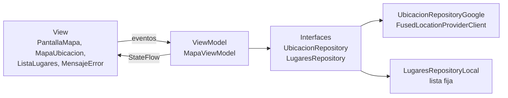
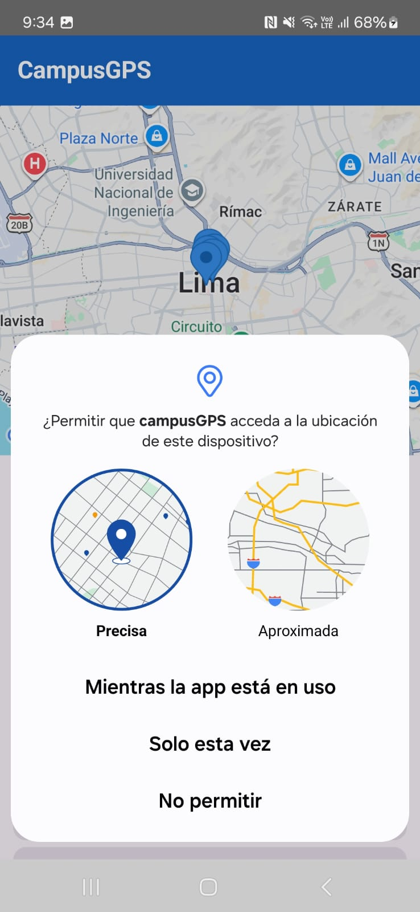
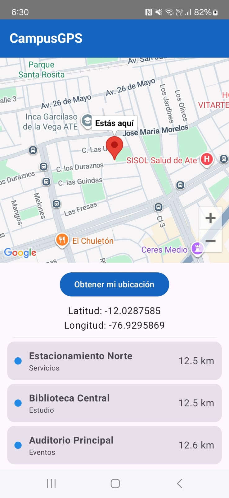
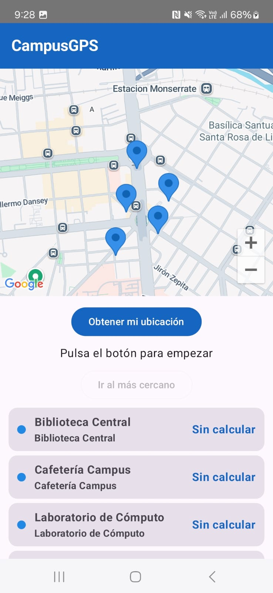
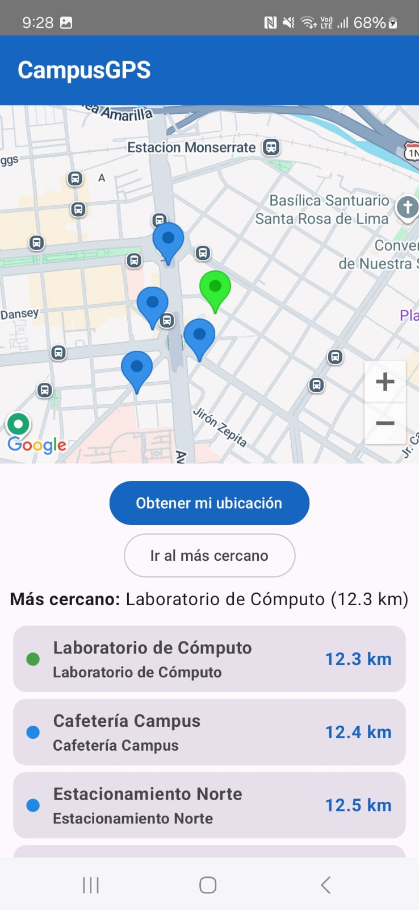
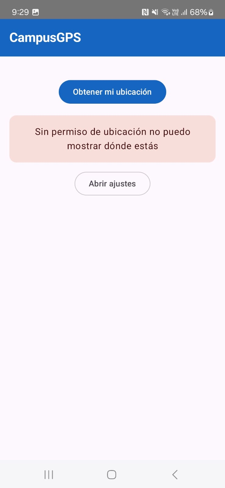
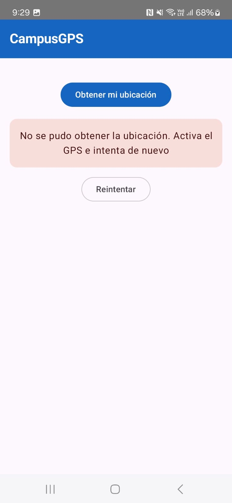

# CampusGPS

App Android (Kotlin + Jetpack Compose) que obtiene la ubicación del usuario, la muestra en un mapa de Google Maps junto con lugares ficticios de un campus, los ordena por distancia y destaca el más cercano. Usa arquitectura **MVVM + Repository**.

## Funcionalidades

- Solicitud de permiso de ubicación en tiempo de ejecución.
- Mapa con marcador propio y 5 lugares (título y categoría).
- Lista ordenada por distancia, con selección que mueve la cámara.
- Lugar más cercano en verde y botón **Ir al más cercano**.
- Manejo de errores: permiso denegado, GPS apagado y sin Google Play Services.

## Estructura de paquetes

```
com.faustino.campusGPS
├── MainActivity.kt
├── data
│   ├── LugaresRepository.kt
│   ├── LugaresRepositoryLocal.kt
│   ├── UbicacionRepository.kt
│   └── UbicacionRepositoryGoogle.kt
├── model
│   └── Modelos.kt
├── ui
│   ├── ListaLugares.kt
│   ├── MapaUbicacion.kt
│   ├── MensajeError.kt
│   ├── PantallaMapa.kt
│   └── theme
├── util
│   ├── Distancia.kt
│   └── Formato.kt
└── viewmodel
    ├── CampusViewModelFactory.kt
    └── MapaViewModel.kt
```

## Arquitectura MVVM



La View solo habla con su ViewModel. El ViewModel depende de interfaces y no recibe `Context`. Las distancias se calculan en el ViewModel con funciones de `util`.

## Configuración

1. Crea una clave de **Maps SDK for Android** en Google Cloud y restríngela a `com.faustino.campusGPS` y tu SHA-1.
2. Agrega en `local.properties` (archivo ignorado por Git):
   ```
   MAPS_API_KEY=tu_clave
   ```
3. Ejecuta la app en un dispositivo o emulador con Google Play.

## Capturas

| Permiso | Mapa con mi ubicación | Marcadores |
|---|--|---|
|  |  |  |

| Lista ordenada | Error | Error GPS desactivado |
|---|---|---|
|  |  |  |

## Para pensar

**1. ¿Por qué `FusedLocationProviderClient` está dentro del Repository y no en el ViewModel?**

Porque necesita un `Context` y es una dependencia de Android y de Google. Si el ViewModel la usara, quedaría atado al framework, sería difícil de probar y podría filtrar el `Context`. El Repository la oculta detrás de una interfaz: el ViewModel solo pide una posición y se puede cambiar la fuente sin tocarlo.

**2. ¿Qué diferencia hay entre el permiso de ubicación y la clave de API de Maps? ¿Qué pasa si falta cada uno?**

El permiso lo concede el usuario para que la app lea su ubicación. La clave identifica a la app ante Google para usar el Maps SDK. Sin permiso no hay ubicación: el mapa se ve, pero no hay marcador propio y la app muestra el error con **Abrir ajustes**. Sin clave (o mal restringida) el mapa sale gris o en blanco y Logcat muestra `Authorization failure`, aunque la ubicación sí funciona.

**3. ¿Por qué la clave va en `local.properties` y no en el código? ¿Qué harías si se subiera a GitHub por error?**

`local.properties` está en `.gitignore`, así que no entra al repositorio. En el código quedaría en el historial público. Si se subiera, borraría la clave y crearía una nueva en Google Cloud (restringida a mi paquete y SHA-1), la quitaría del repositorio y la guardaría de nuevo en `local.properties`. Borrarla solo del último commit no basta porque el historial la conserva.

**4. ¿Dónde calculas la distancia y por qué no en el Composable?**

En el ViewModel (`actualizarDistancias`), con `distanciaMetros` de `util`. Un Composable se recompone muchas veces y repetiría el cálculo; además la lógica no es de interfaz, no se puede probar fácilmente y se perdería al rotar. En el ViewModel se calcula una vez por búsqueda y el resultado se conserva.

**5. ¿Qué pasa con tu app si el usuario niega el permiso dos veces? ¿Cómo lo manejas?**

Android deja de mostrar el cuadro y el resultado llega como negado de inmediato. La app no se cierra: muestra el mensaje de error y el botón **Abrir ajustes**, que abre la pantalla de la app con `ACTION_APPLICATION_DETAILS_SETTINGS`, para que el usuario active el permiso a mano.