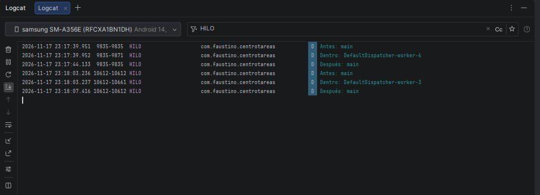
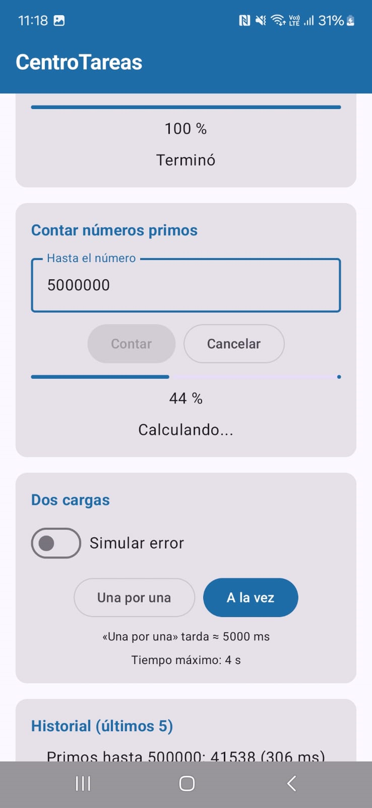
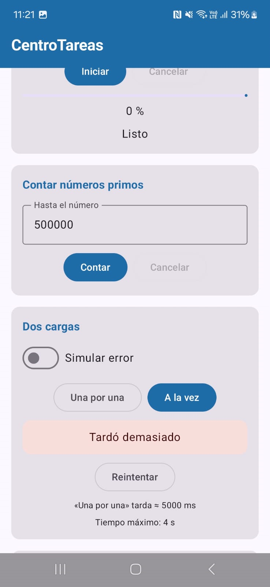
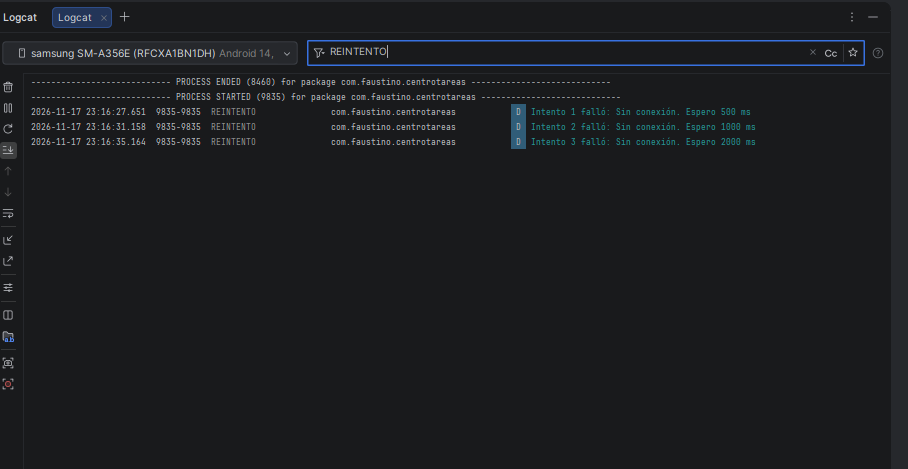
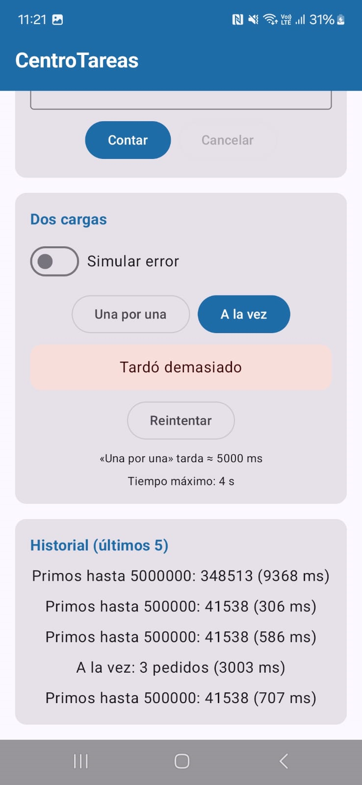

# PROMPTS.md · Fase 2 (rama `mejora-ia-Lab14`)

Herramienta usada: Gemini en Android Studio.

Método de trabajo: en cada mejora le pasé a Gemini el contexto del proyecto, la mejora
pedida, las reglas obligatorias (sin `GlobalScope`, `runBlocking` ni `Thread.sleep`,
sin `Context` en el ViewModel, relanzar siempre `CancellationException`) y al final le
pedí que me mostrara el plan antes de tocar el código. Revisé cada plan, lo confirmé y
después probé la app en el celular.

| Prompt que escribí | Qué respondió Gemini | Qué cambié o descarté | Por qué |
|---|---|---|---|
| **Mejora 1 · Progreso desde el Repository con Flow**  Estoy trabajando en una app Android llamada CentroTareas (Kotlin, Jetpack Compose, Material 3, package com.faustino.centrotareas) con arquitectura MVVM + Repository. Archivos involucrados: data/TareasRepository.kt (interface), data/TareasRepositoryLocal.kt, viewmodel/TareasViewModel.kt y ui/PantallaTareas.kt.  Situación actual: en TareasViewModel, la función tareaLarga() simula una tarea de ~4 segundos dentro del propio ViewModel: un for de 1..100 donde cada vuelta hace `withContext(Dispatchers.Default) { delay(40) }` y actualiza _progreso con i / 100f. Además tiene: un Job? llamado trabajo, un StateFlow corriendo (se pone en false en un bloque finally), la función cancelar() que cancela el Job y pone el mensaje "Cancelado", los mensajes "Trabajando..." y "Terminó", y Log.d("HILO", ...) con Thread.currentThread().name antes, dentro y después del trabajo.  Mejora que quiero: mover la tarea simulada al Repository y exponer el progreso como un Flow. • En la interface TareasRepository agregar: `fun progresoTarea(): Flow<Float>` • En TareasRepositoryLocal implementarla con `flow { ... emit(i / 100f) ... }.flowOn(Dispatchers.Default)`, 100 pasos con delay(40) cada uno (total ≈ 4 s). • En TareasViewModel, tareaLarga() debe recolectar ese Flow con collect y actualizar _progreso. Debe seguir cumpliendo exactamente lo mismo que ahora: si ya está corriendo no hace nada, guarda el Job en trabajo, pone corriendo en false en finally (termine bien o cancelada), progreso empieza en 0f, mensaje "Trabajando..." al empezar y "Terminó" al terminar, cancelar() sigue igual, y se mantienen los Log.d("HILO", ...) (el log "Dentro" debe hacerse dentro del flow para que muestre el hilo DefaultDispatcher-worker).  Reglas obligatorias: • La UI (PantallaTareas.kt) NO debe cambiar y debe verse igual. • El ViewModel solo conoce la interface TareasRepository, nunca Context ni Composables. • Prohibido GlobalScope, runBlocking y Thread.sleep. • No hacer emit dentro de withContext dentro de flow { } (rompe la regla de invariante de Flow); para cambiar de hilo usar flowOn. • No atrapar CancellationException sin volver a lanzarla. • No agregar librerías ni tocar archivos de Gradle.  IMPORTANTE: antes de tocar el código, muéstrame el plan que vas a seguir: qué archivos vas a modificar, qué cambia en cada uno y las firmas nuevas. No modifiques nada hasta que yo te confirme el plan. | Propuso agregar `progresoTarea(): Flow<Float>` a la interface, implementarlo con `flow { for (i in 1..100) { delay(40); emit(i / 100f) } }.flowOn(Dispatchers.Default)` y que el ViewModel lo recolecte con `collect`, dejando la pantalla sin cambios. | No cambié nada: el plan estaba correcto. Verifiqué que no hubiera `withContext` dentro del `flow {}` y que se conservaran el `finally`, el bloqueo de doble inicio, `cancelar()` y los logs `HILO`. | Hacer `emit` dentro de `withContext` rompe la regla de invariante de `Flow`; `flowOn` cambia el hilo de forma segura. Además el trabajo pasa al Repository y el ViewModel solo lo llama, como pide la arquitectura. |
| **Mejora 2 · Primos con progreso**  Seguimos con la app CentroTareas (Kotlin, Jetpack Compose, Material 3, package com.faustino.centrotareas, MVVM + Repository). Archivos involucrados: data/TareasRepository.kt, data/TareasRepositoryLocal.kt, viewmodel/TareasViewModel.kt y ui/PantallaTareas.kt.  Situación actual: TareasRepositoryLocal.contarPrimos(hasta: Int): Int usa withContext(Dispatchers.Default), recorre de 2 a hasta, llama a ensureActive() en cada vuelta y cuenta los primos con la función privada esPrimo(n). En el ViewModel, contar(hasta) pone PrimosUi.Calculando, mide el tiempo con System.currentTimeMillis(), al terminar pone PrimosUi.Listo(cantidad, ms), y si lo cancelan pone PrimosUi.Cancelado y vuelve a lanzar la CancellationException. cancelarPrimos() cancela el Job. En la pantalla, la tarjeta "Contar números primos" tiene un OutlinedTextField, botones Contar y Cancelar, y el resultado en un recuadro verde.  Mejora que quiero: mostrar el porcentaje del cálculo mientras avanza. • Repository: cambiar la firma a `suspend fun contarPrimos(hasta: Int, onProgreso: (Float) -> Unit): Int` (en la interface y en la implementación). Dentro del ciclo, informar el progreso con valores de 0f a 1f, pero SOLO cuando el porcentaje entero cambie (para no llamar al callback millones de veces). Calcular el porcentaje con Long para evitar desbordamiento (n * 100L / hasta). Mantener withContext(Dispatchers.Default), ensureActive() y esPrimo(). • ViewModel: agregar `private val _primosProgreso = MutableStateFlow(0f)` y su versión pública primosProgreso: StateFlow<Float> (solo lectura). En contar(hasta): poner el progreso en 0f al empezar y pasar `{ _primosProgreso.value = it }` como onProgreso. Todo lo demás (estados PrimosUi, tiempo, Cancelado, relanzar la CancellationException) queda igual. • Pantalla: dentro de la tarjeta "Contar números primos", mientras el estado sea PrimosUi.Calculando, mostrar un LinearProgressIndicator con primosProgreso y debajo el texto del porcentaje (por ejemplo "62 %"), centrados como el resto de la tarjeta. Cuando no esté calculando, no se muestra. El resto de la tarjeta no cambia.  Reglas obligatorias: • NO modificar model/Estados.kt (PrimosUi y CargaUi se quedan igual). • El resultado debe seguir siendo correcto: 168 primos hasta 1000 y 41538 hasta 500000. • Prohibido GlobalScope, runBlocking y Thread.sleep. • El ViewModel solo conoce la interface del Repository, sin Context ni Composables; la View no lanza corrutinas. • No atrapar CancellationException sin volver a lanzarla. • No agregar librerías ni tocar Gradle.  IMPORTANTE: antes de tocar el código, muéstrame el plan que vas a seguir: qué archivos vas a modificar, qué cambia en cada uno y las firmas nuevas. No modifiques nada hasta que yo te confirme el plan. | Propuso la nueva firma en interface e implementación, calcular el porcentaje con `n * 100L / hasta`, notificar solo al cambiar, exponer `primosProgreso` y mostrar `LinearProgressIndicator` con el porcentaje mientras calcula. | No cambié nada del plan. Yo definí el diseño en el prompt (callback más `StateFlow` aparte) para no tocar `Estados.kt`. Verifiqué que siguieran dando 168 (hasta 1000) y 41538 (hasta 500000), y que `ensureActive()` y el `throw e` de la cancelación se mantuvieran. | `Estados.kt` es un archivo entregado que no debe modificarse. Notificar solo al cambiar el porcentaje evita millones de llamadas, y usar `Long` evita desbordamiento con números grandes. |
| **Mejora 3 · Tiempo máximo con withTimeout**  Seguimos con la app CentroTareas (Kotlin, Jetpack Compose, Material 3, package com.faustino.centrotareas, MVVM + Repository). Archivos involucrados: viewmodel/TareasViewModel.kt y ui/PantallaTareas.kt.  Situación actual: en TareasViewModel, cargarUnaPorUna() y cargarALaVez() ponen CargaUi.Cargando, miden el tiempo con System.currentTimeMillis() y llaman al Repository (perfil tarda 2 s, pedidos 3 s). cargarALaVez() usa async dentro de coroutineScope y await(). Ambas están dentro de try/catch: `catch (e: Exception) { if (e is CancellationException) throw e; _carga.value = CargaUi.Error("No se pudo cargar: ${e.message}") }`. En la pantalla, la tarjeta "Dos cargas" muestra el estado Error en un recuadro con el mensaje y el botón Reintentar (que vuelve a ejecutar cargarALaVez()), y debajo un texto pequeño "«Una por una» tarda ≈ 5000 ms".  Mejora que quiero: tiempo máximo con withTimeout en las cargas. • ViewModel: agregar un companion object con `const val TIEMPO_MAXIMO_MS = 4000L`. Envolver con `withTimeout(TIEMPO_MAXIMO_MS) { ... }` SOLO el trabajo de las cargas (las llamadas al Repository) dentro de cargarUnaPorUna() y cargarALaVez(), dentro del try existente; la medición del tiempo queda fuera del withTimeout. • withTimeout lanza TimeoutCancellationException, que es subclase de CancellationException. Por eso, ANTES del catch (e: Exception) existente, agregar un catch (e: TimeoutCancellationException) que ponga `_carga.value = CargaUi.Error("Tardó demasiado")`. El catch genérico debe seguir relanzando cualquier otra CancellationException con throw e. • Pantalla: debajo del texto "«Una por una» tarda ≈ 5000 ms" agregar otro texto pequeño con el mismo estilo: "Tiempo máximo: X s", calculado con TareasViewModel.TIEMPO_MAXIMO_MS / 1000. El recuadro de error y el botón Reintentar ya existentes se reutilizan tal cual (no crear estados nuevos).  Reglas obligatorias: • NO modificar model/Estados.kt ni el Repository. • El mensaje del timeout debe ser exactamente "Tardó demasiado" y usar el estado CargaUi.Error existente. • Los errores normales (IOException "Sin conexión") deben seguir mostrando "No se pudo cargar: Sin conexión". • Prohibido GlobalScope, runBlocking y Thread.sleep. • No atrapar CancellationException sin volver a lanzarla (excepto la TimeoutCancellationException de withTimeout, que se convierte en estado Error). • No agregar librerías ni tocar Gradle.  IMPORTANTE: antes de tocar el código, muéstrame el plan que vas a seguir: qué archivos vas a modificar, qué cambia en cada uno y el orden de los bloques catch. No modifiques nada hasta que yo te confirme el plan. | Propuso la constante en el `companion object`, envolver con `withTimeout` solo las llamadas al Repository (la medición del tiempo queda fuera), el orden de los `catch` con el timeout primero y el texto "Tiempo máximo: X s" en la pantalla. | Cambié el valor del límite: usé 4 s en lugar de los 2 s del enunciado. También verifiqué que el `catch` del timeout quedara antes del `catch (e: Exception)`. | Con 2 s las dos cargas fallarían siempre (el perfil tarda 2 s y los pedidos 3 s). Con 4 s, **A la vez** (≈ 3 s) funciona y **Una por una** (≈ 5 s) muestra el timeout. `TimeoutCancellationException` es subclase de `CancellationException`: si el `catch` genérico va primero, la relanza y el spinner queda girando para siempre. |
| **Mejora 4 · Reintento automático**  Seguimos con la app CentroTareas (Kotlin, Jetpack Compose, Material 3, package com.faustino.centrotareas, MVVM + Repository). Archivo involucrado: viewmodel/TareasViewModel.kt.  Situación actual: cargarUnaPorUna() y cargarALaVez() ponen CargaUi.Cargando, miden el tiempo con System.currentTimeMillis(), y dentro de un try ejecutan el trabajo envuelto en withTimeout(TIEMPO_MAXIMO_MS) (constante 4000L en el companion object), llamando a repo.cargarPerfil() y repo.cargarPedidos(_simularError.value). Los bloques catch son, en este orden: catch (e: TimeoutCancellationException) que pone CargaUi.Error("Tardó demasiado"), y catch (e: Exception) que relanza con throw e si es CancellationException y si no pone CargaUi.Error("No se pudo cargar: ${e.message}"). El Repository lanza IOException("Sin conexión") cuando simularError es true.  Mejora que quiero: reintento automático antes de mostrar el error. • Crear en el ViewModel una función privada genérica: `private suspend fun <T> conReintentos(bloque: suspend () -> T): T`. Debe intentar ejecutar el bloque y, si lanza IOException, esperar con delay y volver a intentar, hasta 3 reintentos (4 intentos en total). La espera es creciente: empieza en 500 ms y se duplica en cada reintento (500, 1000, 2000 ms). Si después del último reintento sigue fallando, la excepción se propaga normalmente. • Definir las constantes MAX_REINTENTOS = 3 y ESPERA_INICIAL_MS = 500L en el companion object. • Solo se reintenta IOException. NO se deben reintentar ni atrapar TimeoutCancellationException ni CancellationException (dejarlas pasar). • En cargarUnaPorUna() y cargarALaVez(), envolver con conReintentos { ... } el bloque que ya tiene withTimeout, de modo que el reintento quede POR FUERA del withTimeout y cada intento tenga su propio tiempo máximo de 4 s. El valor _simularError.value debe leerse dentro del bloque en cada intento (para que si el usuario apaga el interruptor durante los reintentos, el siguiente intento ya funcione). • En cada fallo reintentable, registrar con `Log.d("REINTENTO", "Intento N falló: mensaje. Espero X ms")`. • Los bloques catch existentes y sus mensajes quedan exactamente igual, en el mismo orden. Cuando se agotan los reintentos, el resultado final sigue siendo CargaUi.Error("No se pudo cargar: Sin conexión").  Reglas obligatorias: • NO modificar model/Estados.kt, el Repository ni la pantalla (PantallaTareas.kt). • Prohibido GlobalScope, runBlocking y Thread.sleep (la espera es con delay). • No atrapar CancellationException sin volver a lanzarla. • No agregar librerías ni tocar Gradle.  IMPORTANTE: antes de tocar el código, muéstrame el plan que vas a seguir: qué archivos vas a modificar, el código de conReintentos y dónde queda colocada en cada función de carga. No modifiques nada hasta que yo te confirme el plan. | Propuso `conReintentos` con un `for` de 3 intentos más un cuarto final, `delay` duplicándose, constantes `MAX_REINTENTOS` y `ESPERA_INICIAL_MS`, logs con la etiqueta `REINTENTO` y envolver el bloque que ya tiene `withTimeout` en las dos funciones de carga. | No cambié nada del plan. Verifiqué que solo atrape `IOException`, que `_simularError.value` se lea dentro del bloque en cada intento y que la espera use `delay`. | Reintentar solo `IOException` evita reintentar timeouts o cancelaciones del usuario. Al ir por fuera del `withTimeout`, cada intento tiene sus propios 4 s; por dentro, el timeout cortaría los reintentos. La espera creciente (backoff exponencial) evita saturar el servidor. |
| **Mejora 5 · Historial de resultados con DataStore**  Seguimos con la app CentroTareas (Kotlin, Jetpack Compose, Material 3, package com.faustino.centrotareas, MVVM + Repository). Archivos involucrados: app/build.gradle.kts (y libs.versions.toml si el proyecto lo usa), MainActivity.kt, data/TareasRepository.kt, data/TareasRepositoryLocal.kt, viewmodel/TareasViewModel.kt, viewmodel/TareasViewModelFactory.kt y ui/PantallaTareas.kt.  Situación actual: MainActivity crea el ViewModel con TareasViewModelFactory(TareasRepositoryLocal()). El ViewModel tiene contar(hasta) (estados PrimosUi: Calculando, Listo(cantidad, ms), Cancelado), cargarUnaPorUna() y cargarALaVez() (estados CargaUi: Cargando, Exito(modo, perfil, pedidos, ms), Error), con reintentos y withTimeout. La pantalla tiene tres tarjetas: "Tarea con progreso", "Contar números primos" y "Dos cargas".  Mejora que quiero: historial de los últimos 5 resultados guardado con DataStore, que se muestre al abrir la app. • Gradle: agregar SOLO la dependencia androidx.datastore:datastore-preferences:1.1.1 (en libs.versions.toml con libs.* si el proyecto lo usa; si no, directo en app/build.gradle.kts). • MainActivity: crear el DataStore con una extensión de nivel superior: `private val Context.dataStore by preferencesDataStore(name = "historial")`, y pasar TareasRepositoryLocal(applicationContext.dataStore) a la factory. El ViewModel y la factory NO deben recibir Context. • Interface TareasRepository: agregar `fun historial(): Flow<List<String>>` y `suspend fun guardarResultado(texto: String)`. • TareasRepositoryLocal: recibe `private val dataStore: DataStore<Preferences>` en el constructor. Guardar la lista como un solo String con stringPreferencesKey("historial"), con los textos separados por saltos de línea, el más reciente primero, máximo 5 (take(5)). historial() lee dataStore.data, usa el operador catch para que, si es IOException, emita emptyPreferences() (si no es IOException, relanzar), y mapea a List<String> (lista vacía si no hay nada). guardarResultado() usa dataStore.edit para agregar el nuevo texto al inicio y recortar a 5; debe atrapar IOException y registrarla con Log.e sin romper la app, y NO atrapar CancellationException. • ViewModel: exponer `val historial: StateFlow<List<String>> = repo.historial().stateIn(viewModelScope, SharingStarted.WhileSubscribed(5_000), emptyList())`. Guardar con repo.guardarResultado(...) SOLO los resultados exitosos: en contar(), cuando llega PrimosUi.Listo, con el texto "Primos hasta $hasta: $cantidad (${ms} ms)"; en cargarUnaPorUna() y cargarALaVez(), cuando llega CargaUi.Exito, con el texto "${modo}: ${pedidos.size} pedidos (${ms} ms)". No guardar Cancelado ni Error. Todo el comportamiento actual (estados, tiempos, reintentos, timeout, cancelación) queda igual. • Pantalla: agregar una cuarta tarjeta "Historial (últimos 5)" debajo de "Dos cargas", con el mismo estilo de Tarjeta, que muestre los textos de historial uno por línea (del más reciente al más antiguo), y si la lista está vacía el texto "Todavía no hay resultados". Al abrir la app debe mostrar lo que ya estaba guardado.  Reglas obligatorias: • NO modificar model/Estados.kt. • No tocar Gradle más que para agregar esa única dependencia. • El ViewModel y la View NO usan Context; la View no lanza corrutinas. • Prohibido GlobalScope, runBlocking y Thread.sleep. • No atrapar CancellationException sin volver a lanzarla.  IMPORTANTE: antes de tocar el código, muéstrame el plan que vas a seguir: qué archivos vas a modificar, qué cambia en cada uno, el cambio exacto de Gradle y las firmas nuevas. No modifiques nada hasta que yo te confirme el plan. | Propuso agregar solo `datastore-preferences:1.1.1` en `libs.versions.toml` y `build.gradle.kts`, `Context.dataStore` en `MainActivity`, guardar la lista como un `String` separado por saltos de línea (máximo 5), `historial()` con `.catch` para `IOException`, `stateIn` en el ViewModel y la tarjeta "Historial (últimos 5)". | No cambié nada del plan. Verifiqué que la dependencia coincidiera con el nombre del `toml` y sincronizara, que `guardarResultado` atrape solo `IOException`, que solo se guarden `Listo` y `Exito`, y que el historial siga ahí al cerrar la app por completo. | El `Context` solo se usa en `MainActivity`, así el ViewModel sigue sin conocer Android. El Repository atrapa su propia `IOException` para que un fallo al guardar no se confunda con un error de carga ni cierre la app. |

## Capturas de la Fase 2

**Mejora 1 · Hilos en Logcat (filtro `HILO`):** `main` antes y después, `DefaultDispatcher-worker` dentro.

**Mejora 2 · Primos con progreso:** barra y porcentaje mientras calcula.

**Mejora 3 · Tiempo máximo:** "Tardó demasiado" y el texto "Tiempo máximo: 4 s".

**Mejora 4 · Reintento automático (Logcat, filtro `REINTENTO`):** los 3 reintentos con esperas de 500, 1000 y 2000 ms.

**Mejora 5 · Historial:** tarjeta con los últimos resultados.

## Resumen de la Fase 2

Commits de la rama `mejora-ia-Lab14`:

1. `feat(progreso): mueve la tarea simulada al Repository con Flow`
2. `feat(primos): muestra el porcentaje del calculo mientras avanza`
3. `feat(timeout): limita el tiempo de las cargas con withTimeout`
4. `feat(reintento): reintenta las cargas hasta 3 veces con espera creciente`
5. `feat(historial): guarda los ultimos 5 resultados con DataStore`

Reglas verificadas en el código final: sin `GlobalScope`, `runBlocking` ni `Thread.sleep`;
la `CancellationException` siempre se relanza (el timeout se atrapa antes por ser una
subclase); el ViewModel y la pantalla no usan `Context`; `Estados.kt` quedó sin
modificaciones.

## Reflexión

La IA propuso planes correctos porque el prompt incluía el contexto, las reglas y la
instrucción de mostrar el plan primero, lo que me permitió revisar antes de que tocara
el código. Mi aporte fue decidir los detalles que el enunciado dejaba abiertos (el valor
del límite de tiempo, dónde colocar el reintento respecto al `withTimeout`, y cómo
pasar el `DataStore` sin romper la arquitectura) y comprobar cada mejora en el celular.