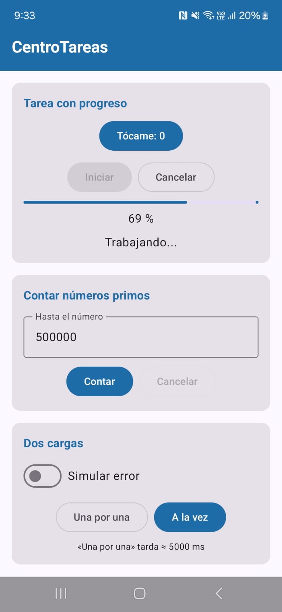
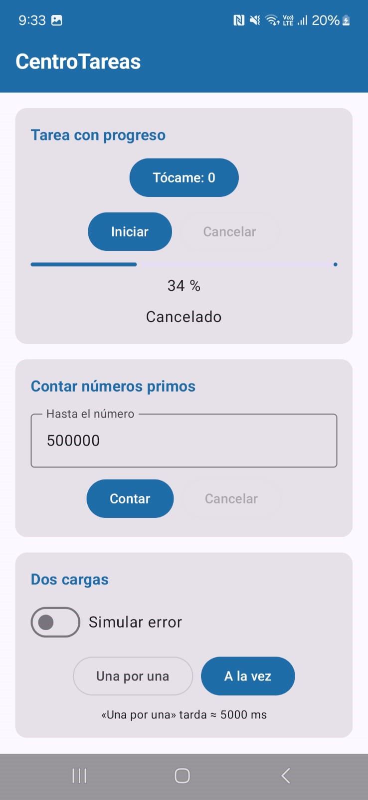
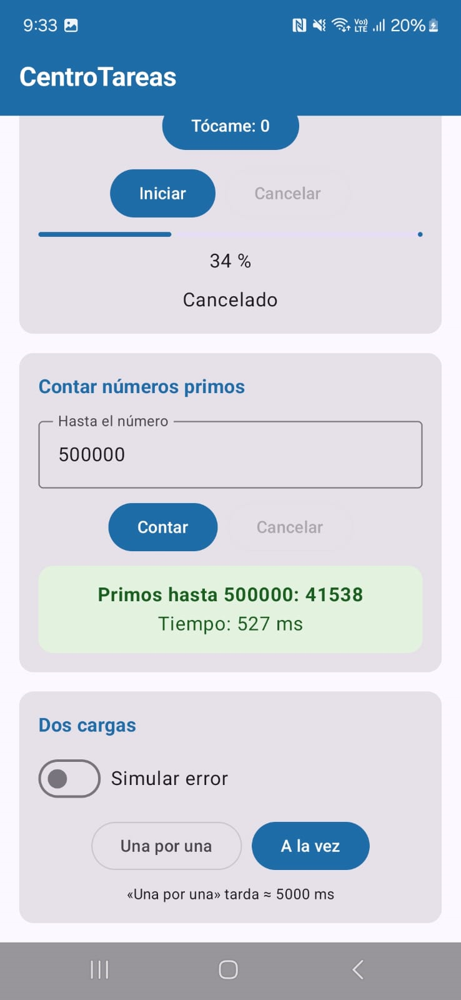
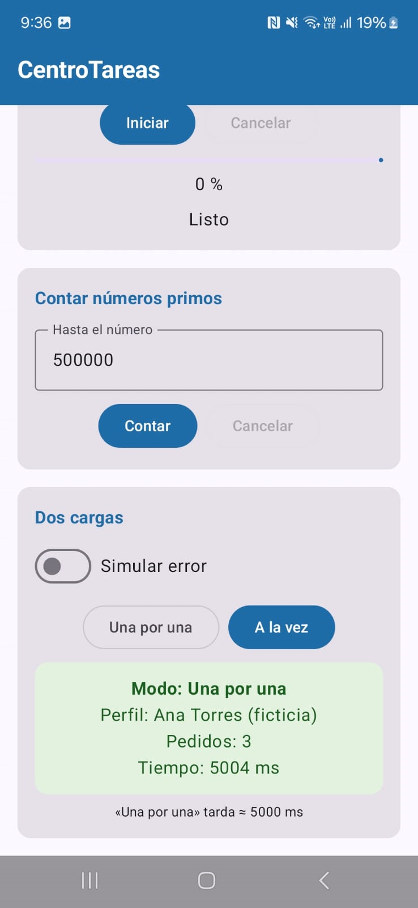
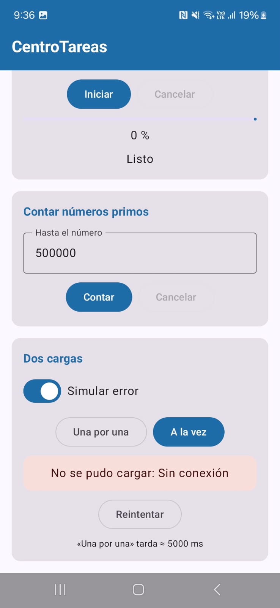

# CentroTareas
Alexander Faustino

App Android hecha con Kotlin, Jetpack Compose y Material 3 que muestra tres tareas
que tardan: una tarea con barra de progreso, un cálculo pesado (contar números primos)
y dos cargas de datos simuladas. Primero se provoca el congelamiento de la pantalla
y después se resuelve con corrutinas, sin bloquear nunca el hilo principal.
Usa el patrón MVVM + Repository.

## Estructura de paquetes

```
com.faustino.centrotareas/
├── MainActivity.kt
├── model/
│   └── Estados.kt                  # PrimosUi, CargaUi
├── data/
│   ├── TareasRepository.kt         # interface
│   └── TareasRepositoryLocal.kt    # cargas simuladas y contarPrimos
├── viewmodel/
│   ├── TareasViewModel.kt
│   └── TareasViewModelFactory.kt
└── ui/
    ├── PantallaTareas.kt
    └── theme/
```

## Arquitectura MVVM + Repository


- **View:** solo muestra el estado y avisa los eventos; no lanza corrutinas.
- **ViewModel:** conoce solo la interface del Repository, lanza las corrutinas con `viewModelScope` y expone `StateFlow`.
- **Repository:** hace el trabajo con funciones `suspend` que no bloquean el hilo.

## Observación del Paso 1

Al tocar "Tarea larga (MAL)", la pantalla se congela 4 segundos: el botón "Tócame"
no suma y el texto "Trabajando..." nunca se ve. Esto pasa porque `Thread.sleep(4000)`
bloquea el hilo principal, que es el mismo que dibuja la interfaz. Compose no puede
redibujar el mensaje mientras el hilo está ocupado, así que solo se ve el resultado
final "Terminó". Si la espera fuera de 10 segundos, Android mostraría el diálogo ANR
("La aplicación no responde"), porque el hilo principal estaría bloqueado más de
unos 5 segundos.

## Capturas

### 1. Tarea con progreso

La barra avanza mientras la tarea trabaja en segundo plano. **Iniciar** queda
deshabilitado y **Cancelar** habilitado.


### 2. Tarea cancelada

Al cancelar a mitad de camino (34 %), la barra se queda donde estaba y el mensaje
cambia a "Cancelado".



### 3. Contar números primos

Primos hasta 500000: **41538**, calculado en 527 ms con `Dispatchers.Default`.


### 4. Una por una contra A la vez

| Una por una (≈ 5000 ms) | A la vez (≈ 3000 ms) |
|:---:|:---:|
|  | |

Una por una tardó 5004 ms (2 s + 3 s) y A la vez 3004 ms (el máximo de las dos),
porque con `async` las dos cargas corren al mismo tiempo.

### 5. Error simulado con Reintentar

Con el interruptor "Simular error" activado, los pedidos fallan con
`IOException("Sin conexión")`. La app muestra el mensaje y el botón **Reintentar**,
sin cerrarse.



## Para pensar

**1. ¿Por qué no se veía "Trabajando..." en el Paso 1?**

Porque `Thread.sleep` bloqueó el hilo principal, que es el encargado de dibujar la UI.
Aunque el mensaje cambió a "Trabajando...", Compose no pudo redibujar la pantalla hasta
que el hilo se liberó, y para entonces el mensaje ya era "Terminó".

**2. ¿Qué diferencia hay entre `Thread.sleep` y `delay`?**

`Thread.sleep` bloquea el hilo: mientras espera, ese hilo no puede hacer nada más.
`delay` es una función `suspend` que suspende solo la corrutina; el hilo queda libre
para otras tareas (como dibujar la UI) y además `delay` es cancelable.

**3. ¿Por qué `Dispatchers.Default` para los primos y `Dispatchers.IO` para la red?**

`Default` tiene tantos hilos como núcleos de CPU y está pensado para trabajo que usa
procesador, como el cálculo de primos. `IO` tiene un pool mucho más grande, pensado para
operaciones que pasan la mayor parte del tiempo esperando (red, disco); así esas esperas
no agotan los hilos que necesita el trabajo de CPU.

**4. ¿Qué pasaría con la corrutina si el usuario cierra la pantalla? ¿Qué papel cumple `viewModelScope`?**

Cuando el usuario cierra la pantalla de forma definitiva, el ViewModel se destruye
(`onCleared`) y `viewModelScope` cancela automáticamente todas sus corrutinas, así no
queda trabajo inútil ni fugas de memoria. En cambio, al rotar la pantalla el ViewModel
sobrevive y la corrutina continúa, por eso el progreso no se reinicia.

**5. ¿Por qué `async` tarda 3 s y no 5 s? ¿Qué pasa si una de las dos cargas falla?**

Porque con `async` las dos cargas corren al mismo tiempo, así que el total es el máximo
(3 s) y no la suma (2 s + 3 s = 5 s). Si una falla, `coroutineScope` cancela la otra
y relanza la excepción, que el `try/catch` del ViewModel captura para mostrar el estado
de error.